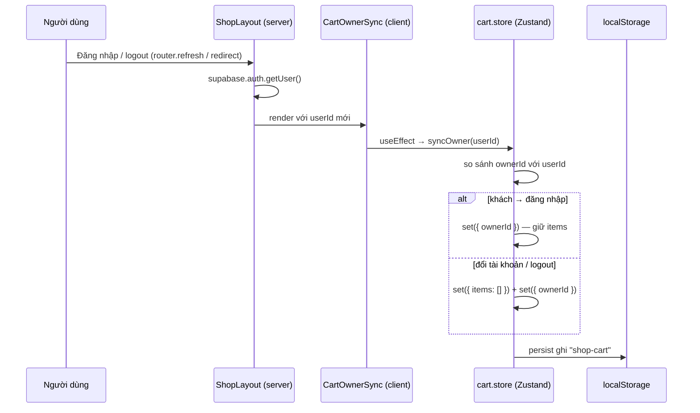

# Đồng bộ giỏ hàng theo tài khoản — 2026-10-15

## Phạm vi thay đổi

Thay đổi **chưa commit** (nằm trong working tree, base là commit `d931267`).

| File | Thay đổi |
|---|---|
| `src/store/cart.store.ts` | Thêm field `ownerId: string \| null` và action `syncOwner(userId)` |
| `src/components/shop/carts/cart-owner-sync.tsx` | **File mới**: Client Component không có UI, gọi `syncOwner` trong `useEffect` |
| `src/app/(shop)/layout.tsx` | Import và render `<CartOwnerSync userId={user?.id ?? null} />` |

**Vấn đề cần giải quyết:** giỏ hàng lưu trong `localStorage["shop-cart"]` (qua `persist` của Zustand, **không phải cookie**). localStorage gắn với trình duyệt chứ không gắn với tài khoản, nên khi A đăng xuất rồi B đăng nhập trên cùng máy, B vẫn thấy giỏ hàng của A.

**Quy tắc nghiệp vụ đã chốt:** khách chưa đăng nhập thêm đồ vào giỏ rồi đăng nhập thì **giữ lại** giỏ hàng.

## Luồng hoạt động

### Quy tắc của `syncOwner`

| `ownerId` hiện tại | `userId` mới | Hành động | Tình huống |
|---|---|---|---|
| `null` | `null` | Không làm gì | Vẫn là khách |
| `null` | `"A"` | Giữ items, `ownerId = A` | Khách đăng nhập |
| `"A"` | `"A"` | Không làm gì | Vẫn là A |
| `"A"` | `"B"` | Xóa items, `ownerId = B` | Đổi tài khoản không logout |
| `"A"` | `null` | Xóa items, `ownerId = null` | Logout |

### Các bước

1. `ShopLayout` (Server Component) gọi `supabase.auth.getUser()` để biết ai đang đăng nhập.
2. Layout truyền `user?.id ?? null` xuống `<CartOwnerSync>`. Chỉ truyền `id`, không truyền cả object `user`.
3. `CartOwnerSync` chạy `useEffect` ở trình duyệt, gọi `syncOwner(userId)`. Lúc này store đã đọc xong localStorage.
4. `syncOwner` so sánh với `ownerId` rồi giữ hoặc xóa giỏ. `persist` tự ghi lại kết quả vào localStorage.
5. Khi đăng nhập (`router.refresh()`) hoặc logout (`redirect("/")` trong Server Action), layout chạy lại với `user` mới. Prop `userId` đổi nên `useEffect` chạy lại.

## Vấn đề phát hiện khi review

| Mức độ | Vấn đề | Gợi ý |
|---|---|---|
| warning | `/checkout/success` chưa tồn tại. `checkout-client.tsx` gọi `router.push("/checkout/success?orderId=...")` sau khi đặt hàng nên sẽ ra trang 404 | Tạo `src/app/(shop)/checkout/success/page.tsx` |
| warning | Giới hạn của cách làm này: A thêm đồ → logout → đăng nhập lại A thì giỏ đã bị xóa. Giỏ hàng chưa thật sự gắn theo tài khoản | Muốn giữ giỏ theo tài khoản và đồng bộ nhiều thiết bị thì chuyển giỏ hàng vào DB (xem follow-up) |
| nitpick | `cart.store.ts` → `syncOwner`: điều kiện `currentOwner !== userId` ở `if` thứ hai bị thừa, vì `if` đầu tiên đã `return` khi hai giá trị bằng nhau | Rút gọn thành `if (currentOwner)` |
| nitpick | `syncOwner` gọi `set` hai lần khi đổi tài khoản, gây 2 lần re-render và 2 lần ghi localStorage | Gộp lại thành `set({ items: [], ownerId: userId })` rồi `return` |
| nitpick | `clearCart()` được gọi trước `router.push` trong checkout, nên có thể chớp nháy trạng thái "giỏ trống" trước khi chuyển trang | Đổi thứ tự, hoặc chuyển việc xóa giỏ sang trang success |
| nitpick | `console.log("layout: ", profile)` trong `ShopLayout` chạy ở mỗi request | Xóa log debug |
| nitpick | `ShopHeader` nhận nguyên object `user`, nên toàn bộ dữ liệu user bị serialize xuống client | Chỉ truyền những field header thực sự cần |

## Giải thích khái niệm liên quan

### Phạm vi của storage ở trình duyệt
`localStorage` và cookie đều theo **trình duyệt + domain**, không biết gì về tài khoản. Dữ liệu "theo người dùng" cần được gắn danh tính (như `ownerId`) hoặc lưu ở server. Server Action (như `logoutAction`) **không chạm được vào localStorage**, vì nó chỉ tồn tại ở client. Server chỉ đọc và ghi được cookie.

### Zustand `persist`
Middleware `persist` tự động lưu state vào storage (mặc định là `localStorage`) dưới key `name`, và đọc lại khi tải trang. Các hàm trong store không được lưu, chỉ dữ liệu được lưu. Dữ liệu cũ chưa có field mới (`ownerId`) sẽ đọc ra là `undefined`, nên cần `?? null`.

### Zustand `get()` và `set()`
- `get()` đọc state hiện tại ngay lúc hàm chạy.
- `set({...})` làm **shallow merge (gộp nông)**: chỉ ghi đè field được truyền vào, field khác giữ nguyên. Vì vậy `set({ ownerId })` không làm mất `items`.

### Guard clause
Xử lý trường hợp đặc biệt rồi `return` sớm, thay vì lồng nhiều `if/else`. Thứ tự các nhánh rất quan trọng: nhánh "không đổi gì" phải nằm đầu tiên.

### `null` và `undefined`
`null === undefined` là `false`. `user?.id` trả về `undefined` khi chưa đăng nhập, nên phải `?? null` để khớp với type `string | null` và để phép so sánh trong `syncOwner` đúng.

### Side effect và `useEffect`
Phần thân component là **render** và phải thuần (pure), không được thay đổi state bên ngoài. Gọi `set` của store là một side effect, nên phải đặt trong `useEffect`. `useEffect` chạy sau khi render và chỉ ở trình duyệt, nên localStorage đã sẵn sàng. Mảng dependency `[userId, syncOwner]` giúp effect chạy lại mỗi khi `userId` đổi. `syncOwner` là hàm ổn định nên không gây chạy thừa.

### Selector của Zustand
`useCartStore((state) => state.syncOwner)` chỉ lấy đúng phần cần dùng. Component chỉ re-render khi phần đó thay đổi.

### Headless "sync" component
Component `return null` chỉ để chạy logic, dùng để nối dữ liệu từ server (ai đang đăng nhập) với state ở client (giỏ hàng). Lợi ích: `ShopLayout` vẫn là Server Component (vẫn `await createClient()` được). Chỉ một mảnh nhỏ là `"use client"`.

### Serialize props từ server sang client
Mọi prop từ Server Component truyền sang Client Component đều được serialize và nhúng vào HTML. Chỉ nên truyền dữ liệu tối thiểu cần dùng (ở đây chỉ `user.id`), vừa gọn vừa tránh lộ thông tin.

### Vì sao layout biết user đã đổi
Layout trong App Router giữ nguyên khi điều hướng giữa các trang con. Nhưng `router.refresh()` (sau khi đăng nhập) và `redirect()` trong Server Action (khi logout) làm Server Component chạy lại, nên `getUser()` trả về user mới và prop mới được truyền xuống.

## Việc cần làm / follow-up

- [ ] Chạy thử 4 kịch bản, theo dõi `shop-cart` trong DevTools → Application → Local Storage:
  1. Khách thêm 2 món → `ownerId: null`, giỏ có 2 món
  2. Đăng nhập A → giỏ vẫn còn 2 món, `ownerId` = id của A
  3. Logout → giỏ trống, `ownerId: null`
  4. Đăng nhập A, thêm đồ → đăng nhập thẳng B → giỏ trống, `ownerId` = id của B
- [ ] Tạo trang `src/app/(shop)/checkout/success/page.tsx`
- [ ] Áp dụng các nitpick ở trên (rút gọn `syncOwner`, xóa `console.log`, giảm prop `user` của header)
- [ ] Nâng cấp sau: lưu giỏ hàng vào DB (bảng `carts` / `cart_items` theo `user_id` + RLS). Khách vẫn dùng localStorage, khi đăng nhập thì **merge** giỏ khách vào giỏ trong DB
