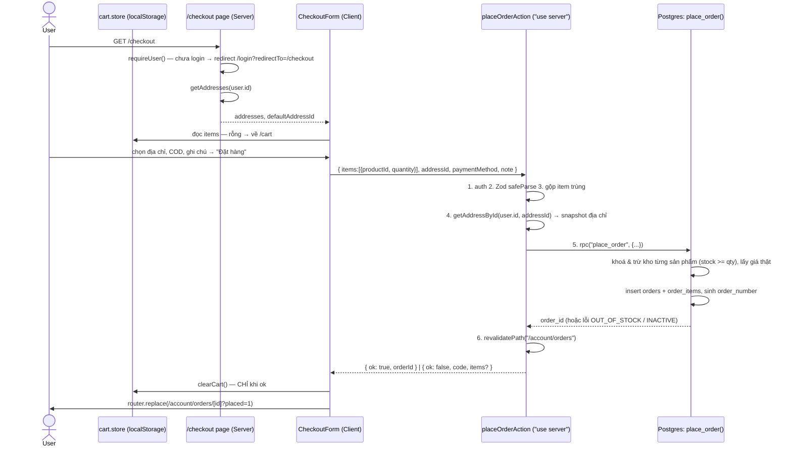
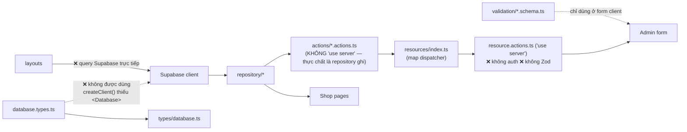
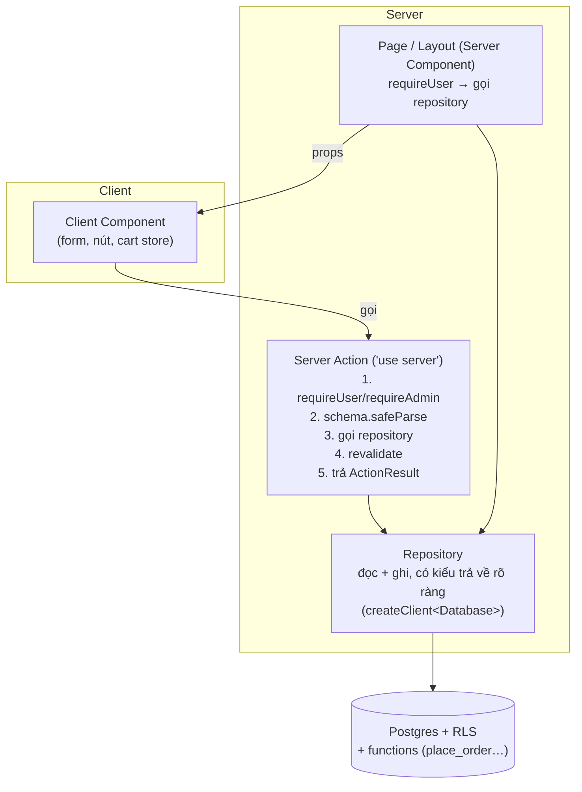

# Checkout giỏ hàng — Hướng giải quyết & Review luồng dữ liệu / cây thư mục

> Ngày: 2026-10-10 · Dựa trên working tree hiện tại (nhiều file shop chưa commit).
> Tài liệu này là **bản thiết kế hướng xử lý**, không phải code hoàn chỉnh — các đoạn code chỉ là khung/pseudo để bạn tự hiện thực.

**Tóm tắt nhanh**

| Phần | Kết luận |
|---|---|
| A. Checkout | Chưa có. Đề xuất làm theo 2 giai đoạn: **MVP** (bắt buộc login, COD, server action + Postgres function) → **mở rộng** (chuyển khoản, guest, cart lưu DB, biến thể). |
| B. Luồng dữ liệu | Pipeline trên giấy đúng, nhưng **bị đứt ở 3 chỗ**: Supabase client không gắn type `Database` (mọi query là `any`), server action **không check quyền & không validate**, folder `actions/` lẫn 2 vai trò. `tsc` hiện báo **14 lỗi** → `npm run build` sẽ fail. |
| C. Cây thư mục | Chưa tối ưu: đặt tên số ít/số nhiều lẫn lộn, `components/shop` nửa phẳng nửa theo folder, file chết/demo, `docs/treeFolder.md` đã lỗi thời. |
| D. Việc cần làm | Danh sách ưu tiên ở cuối tài liệu. |

---

## A. Checkout giỏ hàng — Hướng giải quyết

### A.1 Hiện trạng

- Cart: `src/store/cart.store.ts` (Zustand + `persist` → localStorage). Có `addItem / removeItem / updateQuantity / clearCart / getSubtotal`.
- Trang `/cart` có nút "Thanh toán" → `/checkout` **chưa tồn tại**.
- Đã có sẵn: `addresses` (repo + action), `getMyOrders/getMyOrder`, trang `/account/orders/[id]`.
- DB đã có `orders`, `order_items` (có cột snapshot `product_name`, `price`, `sku`, `subtotal`), `carts`, `cart_items`, `product_variants`. **Chưa có Postgres function nào** (`Functions: {}`), **chưa có thư mục migrations**.
- `createOrder` hiện tại chỉ insert `orders` thô — không có items, không trừ kho, không validate.

### A.2 Quyết định thiết kế (giai đoạn MVP)

| Câu hỏi | Chọn cho MVP | Lý do | Để sau |
|---|---|---|---|
| Ai được checkout? | **Bắt buộc đăng nhập** | RLS đơn giản, có sẵn `addresses` + "Đơn của tôi" | Guest checkout |
| Giỏ hàng lưu ở đâu? | **Giữ localStorage** | Đã chạy được, không cần đổi | Đồng bộ DB khi login (bảng `carts` đã có) |
| Thanh toán | **Chỉ COD** | Không cần tích hợp cổng thanh toán | Chuyển khoản / VNPay / Stripe |
| Tạo đơn thế nào? | **Postgres function `place_order` gọi qua `supabase.rpc()`** | Atomic (1 transaction) + chống bán quá tồn kho | — |
| Ai tính tiền? | **Server/DB**, client chỉ hiển thị ước tính | Client sửa được localStorage | — |
| Biến thể (variant) | **Chưa hỗ trợ** (`variant_id = null`) | `CartItem` chưa có `variantId` | Thêm `variantId` vào cart |

> Nếu chưa muốn học SQL function ngay: có thể làm **tạm** bằng cách gọi tuần tự trong server action (insert order → insert items → update stock). Chạy được nhưng **không atomic** và **bị race condition** khi 2 người mua món cuối cùng. Coi đây là bước học, không phải bản cuối.

### A.3 Luồng tổng thể



### A.4 Hợp đồng dữ liệu (contract)

**Input của action** — `src/lib/validation/checkout.schema.ts`

| Field | Ràng buộc |
|---|---|
| `items` | mảng 1–50 phần tử, mỗi phần tử `{ productId: uuid, quantity: int 1–99 }` |
| `addressId` | uuid |
| `paymentMethod` | `z.enum(PAYMENT_METHODS)` — MVP chỉ `"cod"` |
| `note` | string ≤ 500, optional |

**Không** nhận từ client: `price`, `subtotal`, `total`, `user_id`, `shipping_fee`, `status`.

**Output của action** — discriminated union, không `throw` ra UI:

```ts
type PlaceOrderResult =
  | { ok: true; orderId: string; orderNumber: string }
  | { ok: false; code: "UNAUTHORIZED" | "INVALID_INPUT" | "ADDRESS_NOT_FOUND" }
  | { ok: false; code: "OUT_OF_STOCK" | "PRODUCT_UNAVAILABLE"; productIds: string[] }
  | { ok: false; code: "UNKNOWN" }
```

Lý do dùng union thay vì `throw`: ở production, Next che message lỗi của server action → UI chỉ nhận lỗi chung chung. Trả về object có `code` thì UI biết hiển thị gì (vd: đánh dấu đỏ đúng sản phẩm hết hàng).

### A.5 Postgres function `place_order` — các bước (pseudo)

Tạo bằng migration: `supabase migration new place_order` → file SQL trong `supabase/migrations/` (để có version, không gõ tay trên dashboard).

```
place_order(p_items jsonb, p_recipient_name, p_recipient_phone, p_shipping_address,
            p_payment_method, p_note) returns (order_id, order_number)
  SECURITY DEFINER, set search_path = public

  v_user := auth.uid();  nếu null → raise 'UNAUTHORIZED'
  v_subtotal := 0

  FOR mỗi item trong p_items:
     UPDATE products
        SET stock = stock - item.quantity
      WHERE id = item.product_id AND status = 'active' AND stock >= item.quantity
      RETURNING name, sku, price  → nếu không có dòng nào: raise 'OUT_OF_STOCK:<id>'
     gom (name, sku, price, quantity) vào danh sách; v_subtotal += price * quantity

  v_shipping := tính phí ship (vd: 30000, miễn phí nếu v_subtotal >= 500000)
  INSERT orders (user_id = v_user, order_number = sinh từ sequence,
                 status = 'pending', payment_status = 'unpaid', subtotal, shipping_fee,
                 discount = 0, total, recipient_*, shipping_address, note)
  INSERT order_items (order_id, product_id, product_name, sku, price, quantity, subtotal) — từng dòng
  RETURN order_id, order_number
```

Điểm mấu chốt:

- `UPDATE ... WHERE stock >= qty` vừa **kiểm tra** vừa **trừ** trong 1 câu lệnh → Postgres khoá dòng, 2 request đồng thời không thể cùng trừ món cuối cùng.
- Có bất kỳ `raise` nào → **toàn bộ** function rollback (không có đơn rỗng, không trừ kho sai).
- Giá lấy từ bảng `products` **bên trong** transaction → không tin client.
- `order_number`: dùng `create sequence order_number_seq` + format `SVN-YYYYMMDD-000123`. Không sinh ở client (dễ trùng).
- Sau khi tạo function: chạy lại `supabase gen types` (xuất **UTF-8**, xem B.2) để `supabase.rpc("place_order")` có type.

**RLS đi kèm**

| Bảng | Policy |
|---|---|
| `orders` | `select` khi `user_id = auth.uid()`; **không** cho user `insert/update` trực tiếp (chỉ qua function) |
| `order_items` | `select` khi order cha thuộc user |
| `products` | `select` công khai với `status = 'active'`; `update` chỉ admin |
| Admin | policy riêng dựa trên `profiles.role = 'admin'` |

### A.6 Phía UI

**File mới**

```
src/app/(shop)/checkout/page.tsx              Server: requireUser, getAddresses, render <CheckoutForm/>
src/components/shop/checkout/
  ├─ checkout-form.tsx                        "use client": đọc cart, useActionState/useTransition, gọi action
  ├─ address-selector.tsx                     radio list địa chỉ + link "Thêm địa chỉ" (/account/addresses)
  ├─ payment-method-selector.tsx              MVP: chỉ COD (disable các lựa chọn khác)
  └─ (dùng chung) components/shop/cart/order-summary.tsx
src/lib/actions/checkout.actions.ts           placeOrderAction
src/lib/validation/checkout.schema.ts
src/lib/repository/order.repository.ts        thêm placeOrder() gọi rpc
src/lib/checkout/pricing.ts                   hàm thuần tính phí ship (dùng cho hiển thị ước tính ở client)
```

> Lưu ý: nếu phí ship tính ở cả `pricing.ts` (client hiển thị) và trong SQL (giá thật) thì 2 nơi phải khớp. MVP chấp nhận phí ship cố định cho đơn giản; số tiền cuối cùng **luôn** lấy theo kết quả trả về từ DB.

**Trạng thái form cần xử lý**

- [ ] Giỏ rỗng → chuyển về `/cart`.
- [ ] User chưa có địa chỉ → hiện nút "Thêm địa chỉ", disable nút đặt hàng.
- [ ] Đang gửi → disable nút, hiện "Đang đặt hàng…" (chống double submit).
- [ ] `OUT_OF_STOCK` / `PRODUCT_UNAVAILABLE` → đánh dấu sản phẩm trong summary, gợi ý giảm số lượng/xoá.
- [ ] Thành công → `clearCart()` rồi `router.replace(...)` (dùng `replace` để bấm Back không quay lại form).
- [ ] Hydration: `persist` đọc localStorage sau khi mount → lần render đầu `items = []`. Đừng redirect "giỏ rỗng" trước khi store **rehydrate xong** (xem `useCartStore.persist.hasHydrated()` / `onFinishHydration`).

### A.7 Chuẩn bị trước khi làm checkout (sửa ở cart)

| Việc | Vì sao |
|---|---|
| Tách `cart/page.tsx` thành `CartView` (client) + `CartItemRow` + `OrderSummary` | `OrderSummary` sẽ dùng lại ở checkout |
| Dùng `getSubtotal()` của store thay vì tự `reduce` trong page | 1 nguồn logic |
| Thêm `stock` vào `CartItem` (hoặc giới hạn `quantity ≤ 99`) | Nút "+" hiện không có giới hạn |
| Tạo `formatPrice()` trong `lib/utils` | `toLocaleString("vi-VN") + " ₫"` đang lặp ở ≥ 6 chỗ |
| Sửa `dropdown-cart.tsx` (link `/carts` sai, nội dung demo) hoặc xoá | |
| Tạo hằng số `ORDER_STATUS`, `PAYMENT_STATUS`, `PAYMENT_METHODS` trong `lib/constants/order.ts` | Dùng chung cho Zod schema, `order.config.ts` (options select), label UI, SQL check — hiện mỗi nơi tự gõ string |

### A.8 Giai đoạn mở rộng (sau MVP)

1. **Huỷ đơn** → function `cancel_order` (chỉ khi `pending`, hoàn lại `stock`).
2. **Admin đổi trạng thái** đơn theo state machine: `pending → confirmed → shipping → delivered`, `pending|confirmed → cancelled`.
3. **Chuyển khoản / cổng thanh toán**: đơn tạo với `payment_status = unpaid`, webhook (Route Handler) cập nhật `paid`.
4. **Guest checkout**: nhập địa chỉ tay, `user_id = null`, tra cứu đơn bằng `order_number + phone`.
5. **Cart lưu DB** + merge localStorage khi login.
6. **Variant**: thêm `variantId` vào `CartItem`, function trừ `product_variants.stock`.

---

## B. Review luồng xử lý dữ liệu

### B.1 Pipeline mong muốn vs thực tế



### B.2 Các vấn đề

| # | Mức | Vấn đề | Hậu quả | Hướng xử lý |
|---|---|---|---|---|
| 1 | **critical** | `createServerClient(...)` / `createBrowserClient(...)` **không truyền generic `<Database>`** (`lib/supabase/server.ts`, `client.ts`, `middleware.ts`) | Mọi query trả về `any` → `database.types.ts` gần như vô dụng; lỗi sai tên cột (vd `orders.slug`) không bị TS bắt | `createServerClient<Database>(...)`. Sau đó TS sẽ báo thêm lỗi — đó là lỗi **thật** đang bị che |
| 2 | **critical** | `resource.actions.ts` (create/update/delete mọi resource) **không kiểm tra user là admin** | Server action là **endpoint HTTP công khai**; `admin/layout.tsx` chỉ chặn *trang*, không chặn *action*. Chỉ còn RLS bảo vệ | Tạo `requireAdmin()` và gọi ở **đầu mọi** admin action |
| 3 | **critical** | Server action **không validate** input: `resource.actions`, `addresses.actions`, `profile.actions` nhận object thô; `index.ts` cast `data as never` | Mass assignment: client gửi field bất kỳ (vd `total: 0`, `user_id` người khác) | `schema.safeParse(data)` trong action; gắn schema vào từng resource |
| 4 | **critical** | `tsc --noEmit` báo **14 lỗi** | `npm run build` fail | Xem B.3 |
| 5 | **critical** | `getOrderBySlug` lọc `.eq("slug", …)` nhưng `orders` **không có cột `slug`** | Trang `/admin/orders/[slug]` luôn lỗi | Admin orders dùng `id` (hoặc `order_number`) làm route param |
| 6 | warning | Folder `lib/actions/` chứa **2 loại file khác nhau**: `product/category/brand/order.actions.ts` (không `"use server"`, thực chất là hàm ghi DB) và `resource/addresses/profile/auth/media.actions.ts` (server action thật) | Dễ import nhầm từ client; khó biết đâu là "cửa vào" của server | Chuyển hàm ghi DB vào `repository/*.repository.ts` (repository = **mọi** truy cập DB, cả đọc lẫn ghi). `actions/` chỉ chứa file `"use server"` |
| 7 | warning | Lặp lại `supabase.auth.getUser()` + check ở 21 chỗ; xử lý không thống nhất (`addresses/page.tsx` trả `null`, `orders/page.tsx` redirect) | Dễ quên check, hành vi lộn xộn | `lib/auth/session.ts`: `getCurrentUser()` (bọc `cache()` của React), `requireUser(redirectTo)`, `requireAdmin()` |
| 8 | warning | `(shop)/layout.tsx` và `admin/layout.tsx` query `profiles` trực tiếp, bỏ qua `profile.repository.ts` | Vỡ quy ước "chỉ repository chạm DB" | Dùng `getProfileById` (thêm cột `role`) |
| 9 | warning | Session không được refresh: `updateSession()` có nhưng chưa nối. **Next 16 đổi `middleware.ts` → `proxy.ts`** | Token hết hạn → user bị "đăng xuất" ngẫu nhiên ở Server Component | Tạo `src/proxy.ts` gọi `updateSession` (đọc `node_modules/next/dist/docs/01-app/03-api-reference/03-file-conventions/proxy.md`) |
| 10 | warning | Types chỉ có `Row/Insert/Update`, nhưng repository trả về dữ liệu **có join** (`product_images`, `category`, `brand`, `image`) | Component khai báo `product: Product` rồi đọc `product.product_images` → lỗi TS | Thêm type theo **hình dạng query**: `ProductWithRelations = Product & { product_images: ProductImages[]; category: … }`, hoặc dùng `QueryData<typeof query>` của supabase-js. Repository khai báo kiểu trả về rõ ràng |
| 11 | warning | `revalidateResource` chỉ revalidate `/admin/...` | Admin sửa sản phẩm, storefront (`/`, `/products/[slug]`) có thể vẫn hiện dữ liệu cũ | Revalidate cả đường dẫn shop liên quan (hoặc dùng tag) |
| 12 | warning | Xử lý lỗi lẫn lộn: chỗ `throw new Error(error.message)`, chỗ `throw "Failed to…"`, chỗ trả `null` | UI không biết lỗi gì | Repository: `throw` (hoặc trả `null` cho "không tìm thấy"); Action: bắt lỗi → trả `ActionResult` (như A.4) |
| 13 | warning | `status`, `payment_status`, `payment_method` là `string` tự do ở DB, Zod, config — mỗi nơi tự định nghĩa | Dữ liệu rác, config `product.status` có `"archieved"` (sai chính tả) | Hằng số dùng chung (A.7) + `CHECK` constraint ở DB |
| 14 | nitpick | `console.log` debug: `createProduct` (6 dòng), `(shop)/layout.tsx`, `[slug]/page.tsx`, `admin/[resource]/page.tsx`; `return data` không bao giờ chạy sau `return data.map(...)` trong `getProducts`, `getFeatureProducts` | Log rò rỉ dữ liệu ra server log | Xoá |
| 15 | nitpick | `getProducts` / `getFeatureProducts` lặp gần y hệt (select + sort ảnh) | | Tách hằng `PRODUCT_SELECT` và hàm `withPrimaryImage(product)` |
| 16 | nitpick | `(shop)/[resource]` dùng `resourceConfig` của **admin** chỉ để kiểm tra route | Storefront phụ thuộc metadata form admin | Dùng route tường minh `(shop)/products`, `(shop)/categories` |
| 17 | nitpick | `database.types.ts` lưu **UTF-16 LE** (do `>` của PowerShell khi gen types) | grep/diff/công cụ đọc sai | Gen lại trong Git Bash, hoặc `... \| Out-File -Encoding utf8 src/lib/supabase/database.types.ts` |

### B.3 Lỗi TypeScript hiện tại (`npx tsc --noEmit`)

| File | Lỗi | Nguyên nhân gốc |
|---|---|---|
| `(shop)/account/page.tsx` | "is not a module" | File **rỗng** — thêm nội dung hoặc xoá |
| `product-card.tsx`, `product-detail.tsx` | `product_images` không tồn tại trên `Product` | Vấn đề #10 |
| `(shop)/page.tsx`, `(shop)/[resource]/page.tsx` | `any[] \| null` không gán được cho `Product[]` | Vấn đề #1 + #10 |
| `(shop)/[resource]/[slug]/page.tsx` / `category-detail.tsx` | Truyền mảng vào chỗ cần 1 object (và ngược lại) | Kiểu prop `products` của `CategoryDetail` khai báo sai (`Product` thay vì `Product[]`) |
| `brand/category/order/product.config.ts` | Thiếu `description`, `related` | `ResourceConfig` bắt buộc 2 field này; `related: []` lại là **tuple rỗng**. Cho `description?: string`, `related?: string[]` |

### B.4 Luồng dữ liệu đề xuất (đích đến)



Nguyên tắc: **chỉ repository chạm Supabase**; **chỉ server action là cửa vào để ghi**; **mọi cửa vào đều check quyền + validate**; RLS là lớp bảo vệ cuối cùng chứ không phải lớp duy nhất.

---

## C. Review cây thư mục

### C.1 Vấn đề

| Mức | Vấn đề | Chi tiết |
|---|---|---|
| warning | **Tài liệu lệch thực tế** | `docs/treeFolder.md` ghi `lib/repositories/`, `lib/validations/`, `resource-table/resource-table.tsx`; thực tế là `lib/repository/`, `lib/validation/`, `resource-table/data-table.tsx`. Không có admin `fields/` riêng như tài liệu |
| warning | **Số ít / số nhiều lẫn lộn** | `addresses.repository.ts`, `addresses.actions.ts`, `product-images.repository.ts`, `customer-orders.repository.ts` vs `product.repository.ts`, `category.actions.ts`; folder `shop/carts/` vs `shop/category/`, `shop/product/` |
| warning | **`components/shop/` nửa phẳng nửa theo feature** | Phẳng: `product-card.tsx`, `product-section.tsx`, `hero-section.tsx`, `shop-header.tsx`, `shop-footer.tsx`. Theo folder: `product/`, `category/`, `carts/`, `account/`, `layout/` |
| warning | **`lib/resources/` ôm thứ không thuộc về nó** | `repositories.ts` (map repository), `product-image.types.ts` (type), `config.ts` (code chết, không ai import) |
| warning | **`lib/actions/` lẫn 2 vai trò** | Xem B.2 #6 |
| nitpick | File demo/thừa | `app/admin/data.json` (template shadcn dashboard), `shop/carts/dropdown-cart.tsx`, `(shop)/account/page.tsx` rỗng |
| nitpick | Trùng tên dễ nhầm | `components/shop/layout/dropdown-menu.tsx` vs `components/ui/dropdown-menu.tsx` |
| nitpick | Đặt tên theo thư viện, PascalCase | `components/lexkit/TextEditor.tsx` (các file khác đều kebab-case) |
| nitpick | Thiếu chỗ cho | `proxy.ts`, `lib/auth/`, `lib/constants/`, `supabase/migrations/` |
| nitpick | `docs/architect..md` | Thừa dấu chấm |

### C.2 Cây đề xuất

Quy ước: **tên entity số ít, kebab-case** cho file (`address.repository.ts`), **folder theo feature** trong `components/shop`.

```
src/
├─ proxy.ts                          ← MỚI: gọi updateSession (Next 16)
├─ app/
│  ├─ (auth)/login, register
│  ├─ (shop)/
│  │  ├─ page.tsx
│  │  ├─ products/page.tsx, products/[slug]/page.tsx     ← thay (shop)/[resource]
│  │  ├─ categories/page.tsx, categories/[slug]/page.tsx
│  │  ├─ cart/page.tsx
│  │  ├─ checkout/page.tsx                               ← MỚI
│  │  └─ account/ (page, profile, addresses, orders/[id])
│  └─ admin/
│     ├─ [resource]/ (page, new, [slug])
│     └─ media-library/
├─ components/
│  ├─ ui/                            shadcn — không import gì từ shop/admin/lib nghiệp vụ
│  ├─ editor/rich-text-editor.tsx    ← đổi từ lexkit/TextEditor.tsx
│  ├─ admin/ (resource-table, resource-form, media-library, product-images, layout/…)
│  └─ shop/
│     ├─ layout/   header.tsx, footer.tsx, cart-button.tsx, user-menu.tsx
│     ├─ home/     hero-section.tsx
│     ├─ product/  product-card.tsx, product-section.tsx, product-detail.tsx
│     ├─ category/ category-card.tsx, category-section.tsx, category-detail.tsx
│     ├─ cart/     cart-view.tsx, cart-item-row.tsx, order-summary.tsx, add-to-cart-button.tsx
│     ├─ checkout/ checkout-form.tsx, address-selector.tsx, payment-method-selector.tsx
│     └─ account/  …(giữ nguyên)
├─ lib/
│  ├─ supabase/   client.ts, server.ts, middleware.ts, database.types.ts (UTF-8)
│  ├─ auth/       session.ts  (getCurrentUser, requireUser, requireAdmin)       ← MỚI
│  ├─ constants/  order.ts    (ORDER_STATUS, PAYMENT_STATUS, PAYMENT_METHODS)  ← MỚI
│  ├─ repository/ product, category, brand, order, address, profile, media, product-image
│  │              (.repository.ts — cả đọc lẫn ghi; gộp *.actions.ts không-"use server" vào đây)
│  ├─ validation/ *.schema.ts + checkout.schema.ts
│  ├─ actions/    CHỈ file "use server": resource, checkout, address, profile, auth, media, product-image
│  ├─ resources/  types.ts, field-utils.ts, *.config.ts, index.ts (registry)
│  │              (bỏ config.ts; repositories.ts gộp vào registry)
│  ├─ checkout/   pricing.ts                                                  ← MỚI
│  └─ utils.ts    (+ formatPrice)
├─ store/cart.store.ts
├─ hooks/
└─ types/database.ts  (+ ProductWithRelations, OrderWithItems…, ProductImage)
supabase/
└─ migrations/   ← MỚI: place_order, RLS, constraints
```

### C.3 Hai lựa chọn cho `lib/` — tổ chức theo **tầng** hay theo **feature**

| | Theo tầng (hiện tại: `repository/`, `actions/`, `validation/`) | Theo feature (`features/order/{repository,actions,schema}.ts`) |
|---|---|---|
| Ưu | Đúng với pipeline trong `crudPageWorkFlow.md`; resource pattern admin dựa vào nó | Mọi thứ của 1 nghiệp vụ (checkout, order) nằm 1 chỗ; xoá/sửa feature dễ |
| Nhược | 1 feature rải ra 4–5 folder | Phải dời nhiều file; lệch với tài liệu hiện có |
| Khi nào | Dự án cỡ hiện tại, đang học pipeline | Khi số feature shop tăng nhiều (coupon, review, wishlist…) |

Gợi ý: **giữ theo tầng**, chỉ chuẩn hoá tên và tách đúng vai trò. Sau khi sửa xong nhớ **cập nhật `docs/treeFolder.md`**.

---

## D. Việc cần làm (theo thứ tự ưu tiên)

### Bước 0 — Commit hiện trạng
- [ ] Chia commit theo tính năng (shop pages, account, cart store…) để có mốc review/rollback.

### Bước 1 — Sửa nền móng (critical, làm trước checkout)
- [ ] Thêm `<Database>` vào `createServerClient` / `createBrowserClient` (+ gen lại types ở UTF-8).
- [ ] Sửa 14 lỗi `tsc` (types có relation, `ResourceConfig` optional fields, file `account/page.tsx` rỗng, prop `CategoryDetail`).
- [ ] Tạo `lib/auth/session.ts` → gọi `requireAdmin()` trong `resource.actions.ts`, `media.actions.ts`, `product-image.actions.ts`.
- [ ] Validate Zod trong mọi server action.
- [ ] Sửa `getOrderBySlug` (orders không có slug).
- [ ] Tạo `src/proxy.ts` gọi `updateSession`.

### Bước 2 — Dọn cấu trúc
- [ ] Dời `product/category/brand/order.actions.ts` (không "use server") vào repository.
- [ ] Xoá `resources/config.ts`, `admin/data.json`, `console.log`; xử lý `dropdown-cart.tsx`.
- [ ] Chuẩn hoá tên file số ít; sắp lại `components/shop/` theo feature.
- [ ] Tạo `lib/constants/order.ts`, `formatPrice`.
- [ ] Cập nhật `docs/treeFolder.md`.

### Bước 3 — Checkout MVP
- [ ] Refactor trang cart (CartView, CartItemRow, OrderSummary).
- [ ] Migration: sequence `order_number`, function `place_order`, RLS cho `orders`/`order_items`.
- [ ] `checkout.schema.ts` → `placeOrder()` trong repository → `placeOrderAction`.
- [ ] Trang `/checkout` + `CheckoutForm` (xử lý hydration, pending, lỗi hết hàng).
- [ ] Sau đặt hàng → `/account/orders/[id]`.

### Bước 4 — Mở rộng
- [ ] `cancel_order`, admin đổi trạng thái đơn.
- [ ] Thanh toán online, guest checkout, cart lưu DB, variant.

### Kiểm tra sau mỗi bước
- `npx tsc --noEmit` không lỗi · `npm run lint` · `npm run build`.
- Test tay checkout: giỏ rỗng · chưa login · chưa có địa chỉ · hết hàng · bấm đặt hàng 2 lần · 2 tab cùng mua món cuối.
