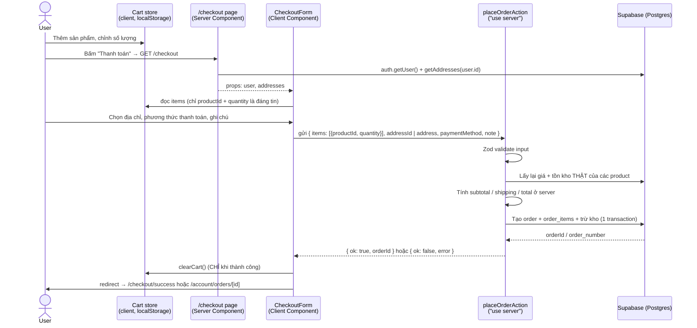
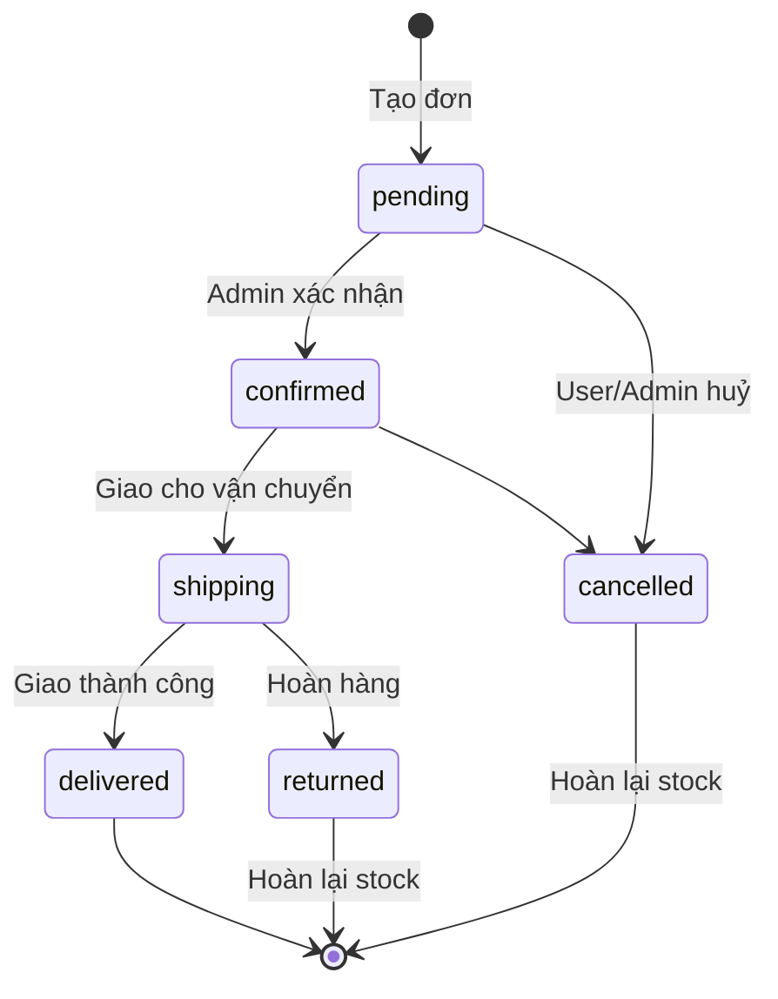
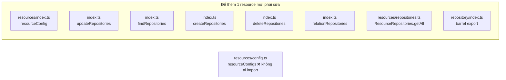
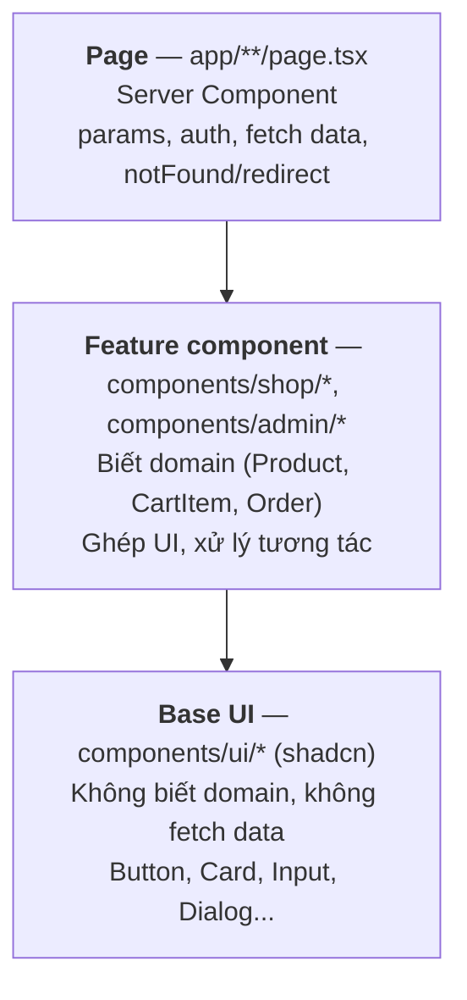
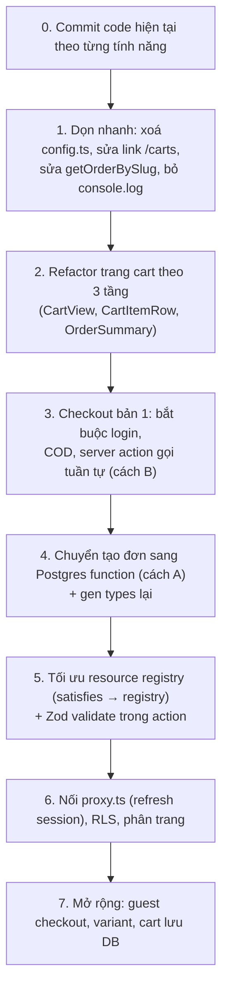

# 02 — Checkout giỏ hàng & Tối ưu code

> Tài liệu học (learning-log), cập nhật khi hiểu biết thay đổi.
> Lần cập nhật: 2026-10-10 — dựa trên code hiện tại trong working tree (chưa commit).

Mục lục:

1. [Quy trình checkout giỏ hàng](#phần-1--quy-trình-checkout-giỏ-hàng)
2. [Tối ưu config & getResource data](#phần-2--tối-ưu-config--getresource-data)
3. [Thiết kế component: page → component → base UI (shadcn)](#phần-3--thiết-kế-component-page--component--base-ui)
4. [Dùng AI review code: tree folder, workflow, performance](#phần-4--dùng-ai-review-code)
5. [Lộ trình đề xuất](#phần-5--lộ-trình-đề-xuất)

Mỗi phần có mục **"Câu hỏi tự kiểm tra"** — hãy thử tự trả lời trước khi đọc tiếp phần sau.

---

## Phần 1 — Quy trình checkout giỏ hàng

### 1.1 Hiện trạng trong code

| Thành phần | File | Trạng thái |
|---|---|---|
| Cart state | `src/store/cart.store.ts` | ✅ Zustand + `persist` → lưu **localStorage** (key `shop-cart`) |
| Nút thêm vào giỏ | `src/components/shop/carts/add-to-cart-button.tsx` | ✅ gọi `addItem` |
| Trang giỏ hàng | `src/app/(shop)/cart/page.tsx` | ✅ hiển thị, +/−, xoá, link sang `/checkout` |
| Badge số lượng | `CartButton` trong `shop-header.tsx` | ✅ |
| Trang checkout | `src/app/(shop)/checkout/` | ❌ **chưa có** → link "Thanh toán" đang 404 |
| Địa chỉ user | `addresses.repository.ts`, `addresses.actions.ts` | ✅ đọc/tạo/sửa |
| Đơn của user | `customer-orders.repository.ts` | ✅ `getMyOrders`, `getMyOrder` |
| Tạo đơn | `order.actions.ts` → `createOrder` | ⚠️ chỉ insert bảng `orders`, không có `order_items`, không trừ kho, **không có `"use server"`** |
| Bảng DB | `carts`, `cart_items` | ⚠️ đã có trong DB nhưng **chưa dùng** (cart đang ở localStorage) |
| Bảng DB | `orders`, `order_items`, `product_variants` | ✅ có sẵn, `orders.user_id` nullable (cho phép guest) |

Sơ đồ nghiệp vụ trong `docs/order-workflow.md`:
`PRODUCT → CART → CHECKOUT (Guest nhập địa chỉ / User chọn địa chỉ) → REVIEW → CREATE ORDER → SUCCESS → MY ORDERS`

### 1.2 Luồng kỹ thuật đề xuất



### 1.3 Nguyên tắc vàng: **Không tin client**

Cart nằm trong localStorage → người dùng mở DevTools là sửa được `price: 1`.
Vì vậy:

- Client chỉ gửi **`productId` + `quantity`** (và `variantId` nếu có).
- Server **tự đọc lại** `price`, `stock`, `status` từ bảng `products` rồi mới tính tiền.
- `subtotal`, `shipping_fee`, `discount`, `total` **luôn tính ở server**.
- `user_id` lấy từ `supabase.auth.getUser()` ở server, **không** nhận từ form.

> 💡 `CartItem.price` trong store chỉ để **hiển thị** cho nhanh. Nếu giá đã đổi khi checkout, server nên báo lại "Giá sản phẩm X đã thay đổi" thay vì âm thầm tính giá mới.

### 1.4 Snapshot dữ liệu trong `order_items`

Bảng `order_items` có `product_name`, `price`, `sku`, `variant_name`, `subtotal` — tức là **copy** thông tin sản phẩm tại thời điểm mua, không chỉ lưu `product_id`.

Tại sao? Vì sau này admin đổi tên/giá hoặc xoá sản phẩm, đơn hàng cũ vẫn phải hiển thị đúng "đã mua cái gì, giá bao nhiêu". (`product_id` cũng nullable chính vì lý do này — sản phẩm bị xoá thì đơn vẫn còn.)
Đây là pattern **"snapshot / denormalize có chủ đích"** — khác với việc chuẩn hoá (normalize) dữ liệu thông thường.

### 1.5 Atomicity — vấn đề quan trọng nhất của "Create order"

Tạo đơn thực chất là **3 bước**:

1. Insert 1 dòng `orders`
2. Insert N dòng `order_items`
3. Trừ `products.stock` cho từng sản phẩm

Nếu bước 2 hoặc 3 lỗi giữa chừng → có đơn "rỗng" hoặc đơn có hàng nhưng kho không trừ. Và nếu 2 người cùng mua món cuối cùng → **race condition**, kho âm.

Các hướng giải quyết:

| Cách | Mô tả | Ưu | Nhược |
|---|---|---|---|
| **A. Postgres function + `supabase.rpc()`** | Viết hàm SQL `create_order(...)` chạy cả 3 bước trong 1 transaction; trừ kho bằng `UPDATE ... SET stock = stock - qty WHERE id = ... AND stock >= qty` | Atomic thật sự, chống race condition, 1 round-trip | Phải học PL/pgSQL; logic nằm trong DB (khó debug hơn); cần tạo migration |
| **B. Gọi tuần tự trong server action** | `insert orders` → `insert order_items` → `update stock`, lỗi thì tự `delete` để rollback | Dễ viết, toàn TypeScript | **Không atomic**: rollback tay có thể cũng lỗi; vẫn bị race condition kho |
| **C. Supabase Edge Function** | Như B nhưng chạy trên Edge Function với service role | Tách biệt khỏi app | Thêm hạ tầng, vẫn cần transaction (thường lại quay về RPC) |

Gợi ý học: làm **B trước** để hiểu luồng, sau đó chuyển sang **A** để hiểu vì sao transaction quan trọng. Hiện `database.types.ts` → `Functions: {}` nghĩa là DB chưa có function nào; khi tạo xong nhớ `gen types` lại để `supabase.rpc("create_order", ...)` có type.

### 1.6 Guest vs User

`orders.user_id` nullable → DB đã chuẩn bị cho guest checkout. Nhưng guest kéo theo nhiều câu hỏi:

- **RLS**: guest dùng role `anon` → cần policy cho phép `anon` insert `orders`? (nguy hiểm) — hoặc dùng RPC `security definer` để kiểm soát chặt.
- **Xem lại đơn**: guest không có tài khoản → tra cứu bằng `order_number` + số điện thoại, hoặc gửi link có token.
- **Địa chỉ**: guest nhập tay, không lưu vào `addresses` (bảng này `user_id` NOT NULL).

| Lựa chọn | Ưu | Nhược |
|---|---|---|
| Bắt buộc đăng nhập (redirect `/login?next=/checkout`) | Đơn giản, RLS dễ, có "My orders" | Giảm tỉ lệ chuyển đổi |
| Cho phép guest | UX tốt hơn | Phức tạp: RLS, tra cứu đơn, chống spam |

Gợi ý: **làm bản bắt buộc đăng nhập trước**, guest là bước mở rộng.

### 1.7 Lưu giỏ hàng ở đâu?

| Cách | Ưu | Nhược |
|---|---|---|
| **localStorage** (hiện tại) | Không cần login, nhanh, không tốn query | Mất khi đổi thiết bị/trình duyệt; dữ liệu giá có thể cũ; **hydration mismatch** (server render badge = 0, client = 3) |
| **DB** (`carts`, `cart_items`) | Đồng bộ đa thiết bị, server biết giỏ hàng | Mỗi thao tác là 1 request; guest không dùng được |
| **Hybrid** | Guest dùng localStorage, khi login thì **merge** vào DB | Tốt nhất về UX, nhưng logic merge phức tạp (trùng sản phẩm thì cộng hay lấy max?) |

Với mức hiện tại, giữ localStorage là hợp lý. Lưu ý vấn đề hydration của `zustand/persist`: lần render đầu ở server luôn là `items: []`. Tìm hiểu `skipHydration` / `onRehydrateStorage` của persist, hoặc chỉ render badge sau khi mounted.

### 1.8 Edge cases cần xử lý

- [ ] Giỏ trống mà vào `/checkout` → redirect về `/cart`.
- [ ] Sản phẩm đã bị xoá / `status != "active"` → báo lỗi, gỡ khỏi giỏ.
- [ ] Hết hàng / `quantity > stock` → báo lỗi cụ thể từng sản phẩm.
- [ ] Giá thay đổi so với lúc thêm vào giỏ → thông báo cho user xác nhận lại.
- [ ] **Double submit** (bấm 2 lần) → disable nút khi pending (`useTransition` / `useActionState`), và cân nhắc idempotency key.
- [ ] `order_number` phải **unique** và dễ đọc (vd `SVN-20261010-0001`) — sinh ở DB (sequence) an toàn hơn sinh ở client.
- [ ] Chỉ `clearCart()` **sau khi** server trả về thành công.
- [ ] COD: `payment_status = "unpaid"`, `status = "pending"`.
- [ ] `product_variants` đã có trong DB nhưng `CartItem` chưa có `variantId` → quyết định có hỗ trợ biến thể ngay không.

### 1.9 Vòng đời đơn hàng (state machine)



`status` (trạng thái giao hàng) và `payment_status` (`unpaid` / `paid` / `refunded`) là **2 trục độc lập** — DB đã tách đúng. Hiện cả hai đều là `string` tự do; nên ràng buộc bằng `z.enum([...])` ở schema và `CHECK` constraint/enum ở DB để tránh lưu giá trị rác.

### 1.10 Cấu trúc file đề xuất (theo pipeline của dự án)

```
src/lib/validation/checkout.schema.ts       # Zod: items[], addressId | address, paymentMethod, note
src/lib/repository/order.repository.ts      # (hoặc customer-orders) hàm tạo đơn / gọi rpc
src/lib/actions/checkout.actions.ts         # "use server": auth → validate → tính tiền → tạo đơn
src/app/(shop)/checkout/page.tsx            # Server: getUser, getAddresses, redirect nếu chưa login
src/app/(shop)/checkout/success/page.tsx    # Hoặc dùng luôn /account/orders/[id]
src/components/shop/checkout/
  ├─ checkout-form.tsx                      # "use client": đọc cart store, submit action
  ├─ address-selector.tsx
  ├─ payment-method-selector.tsx
  └─ order-summary.tsx                      # Có thể tái dùng ở trang cart
```

### 1.11 Các vấn đề phát hiện trong code hiện tại (liên quan checkout)

| Mức | Vấn đề | Vị trí |
|---|---|---|
| critical | Link "Thanh toán" trỏ `/checkout` nhưng route chưa tồn tại | `src/app/(shop)/cart/page.tsx` |
| critical | `getOrderBySlug` query `.eq("slug", slug)` nhưng bảng `orders` **không có cột `slug`** → trang admin chi tiết đơn luôn lỗi | `src/lib/repository/order.repository.ts` |
| warning | `order.actions.ts` (và `product/category/brand.actions.ts`) **không có `"use server"`** — chúng chỉ chạy được vì được gọi gián tiếp qua `resource.actions.ts`. Nếu checkout form (client) import trực tiếp `createOrder` sẽ lỗi. Tên folder `actions/` gây hiểu nhầm là server action | `src/lib/actions/*.actions.ts` |
| warning | `createOrder` nhận `OrderInsert` thô — không validate, không có `order_items`, không trừ kho | `src/lib/actions/order.actions.ts` |
| warning | Link "My Cart" trỏ `/carts` (route thật là `/cart`); cả file vẫn là template demo của shadcn (Profile/Billing/Settings) | `src/components/shop/carts/dropdown-cart.tsx` |
| nitpick | Trang cart tự tính `subtotal` bằng `reduce` trong khi store đã có `getSubtotal()` — 2 nguồn logic cho cùng 1 việc | `src/app/(shop)/cart/page.tsx` |
| nitpick | Nút +/− dùng `<button>` thô, không dùng `Button` shadcn; nút "+" không giới hạn theo `stock` | `src/app/(shop)/cart/page.tsx` |

### Câu hỏi tự kiểm tra (Phần 1)

1. Nếu client gửi `total` lên server, điều gì có thể xảy ra? Server nên làm gì thay thế?
2. Tại sao `order_items` lưu `product_name` và `price` thay vì chỉ `product_id`?
3. Hai người cùng đặt mua sản phẩm cuối cùng trong kho. Với cách B (gọi tuần tự), kết quả là gì? Với cách A (RPC + `WHERE stock >= qty`) thì sao?
4. Gọi `clearCart()` trước hay sau khi gọi server action? Tại sao?

---

## Phần 2 — Tối ưu config & getResource data

### 2.1 Hiện trạng: thông tin của 1 resource bị rải ở nhiều nơi



Vấn đề cụ thể:

| Mức | Vấn đề | Giải thích |
|---|---|---|
| warning | **"Shotgun surgery"** — thêm/sửa 1 resource phải chạm 6–8 chỗ | Dễ quên 1 map → lỗi runtime `Unsupported resource` mà TypeScript không báo. Ví dụ: trang list admin phải check cả `config` lẫn `repositories` vì 2 map có thể lệch nhau |
| warning | `src/lib/resources/config.ts` là **code chết** | `resourceConfigs` không được import ở đâu, nội dung lại lỗi thời so với `product.config.ts` (status `in_process` vs `draft/archieved`). Người đọc dễ sửa nhầm file |
| warning | **Không validate ở server boundary** | `updateResourceAction(resource, id, data)` nhận `Record<string, unknown>` từ client rồi `data as never` đẩy thẳng vào DB → client có thể gửi field bất kỳ (**mass assignment**). Zod schema đã có trong `lib/validation/` nhưng không được dùng ở action |
| warning | `as never`, `as keyof typeof`, `item: any` | Ép kiểu = tắt type-check. Cast `resource as keyof typeof resourceConfig` lặp lại ở mọi page |
| warning | `index.ts` trộn **config thuần** (an toàn cho client) với **hàm server** (repository dùng `next/headers`) | Hiện chưa có client component nào import `@/lib/resources`, nhưng chỉ cần 1 lần import nhầm là bundle server code vào client → lỗi build. Nên tách và dùng package `server-only` |
| nitpick | `related: []` trong `ResourceConfig` | Kiểu `[]` là **tuple rỗng** — chỉ chấp nhận mảng rỗng. Có lẽ ý định là `string[]` |
| nitpick | Trang shop `(shop)/[resource]` dùng `resourceConfig` của **admin** chỉ để kiểm tra route hợp lệ | Ghép (coupling) storefront với metadata form admin |
| nitpick | `admin/[resource]/page.tsx`: `if(!data) return []` — page component trả mảng; text cứng "No products found."; còn `console.log` | |

### 2.2 Hướng tối ưu — 3 cách, so sánh

**Cách A — Một registry duy nhất cho mỗi resource**

Ý tưởng: gom mọi thứ của 1 resource vào **1 object**, có type chung:

```ts
// Chỉ là HÌNH DẠNG để hình dung, không phải code hoàn chỉnh
type ResourceDefinition = {
  config: ResourceConfig          // metadata cho UI
  schema: ZodType                 // validate ở server action
  repo: {
    list: () => Promise<...>
    findBySlug: (slug: string) => Promise<... | null>
    create: (data) => Promise<...>
    update: (id, data) => Promise<...>
    remove: (id) => Promise<...>
  }
  relationOptions?: () => Promise<{ value: string; label: string }[]>
}

export const resources = { products: {...}, categories: {...} } satisfies Record<string, ResourceDefinition>
export function getResource(name: string) { /* type guard, trả về definition hoặc null */ }
```

Mọi page/action chỉ cần `const def = getResource(resource); if (!def) notFound()` rồi dùng `def.repo.list()`, `def.schema.parse(data)`…

**Cách B — Giữ nhiều map, nhưng ép TypeScript kiểm tra đủ**

Giữ cấu trúc hiện tại, chỉ thêm `satisfies Record<ResourceName, ...>` cho từng map. Thiếu 1 resource ở map nào → TypeScript báo lỗi ngay khi build.

**Cách C — Generic repository factory**

Vì `getProducts/getCategories/getBrands...` gần như giống hệt nhau (khác tên bảng + select), viết 1 hàm `createCrudRepository("products", { select: "..." })` sinh ra cả bộ CRUD.

| Cách | Ưu | Nhược |
|---|---|---|
| A. Registry | 1 chỗ duy nhất; thêm resource = thêm 1 entry; dễ gắn schema validate | Refactor nhiều file; object registry lớn, phải cẩn thận tách server/client |
| B. `satisfies` từng map | Thay đổi nhỏ nhất, học được `satisfies` | Vẫn rải rác, chỉ an toàn hơn chứ không gọn hơn |
| C. Factory | Xoá rất nhiều code lặp | Trừu tượng hoá sớm; resource đặc thù (orders có items, products có images) khó nhét vào khuôn; generic type Supabase khá khó |

Gợi ý: **B ngay (rẻ) → A khi thêm resource thứ 5** (customers…). C chỉ nên làm khi thật sự thấy đau vì lặp code.

**Bất kể chọn cách nào, nên làm:**

1. Xoá `src/lib/resources/config.ts`.
2. Server action gọi `schema.parse(data)` (hoặc `safeParse`) trước khi ghi DB.
3. Tách `resources/` thành phần **thuần dữ liệu** (config, types, field-utils — client dùng được) và phần **server** (registry có repo/action — thêm `import "server-only"`).

### 2.3 Tối ưu việc lấy dữ liệu (getResource data / performance)

| Vấn đề | Hiện trạng | Hướng cải thiện |
|---|---|---|
| Lấy toàn bộ bảng | `getOrders()` `select("*")`, không phân trang | Chọn cột cần cho table; dùng `.range(from, to)` + `count: "exact"` để phân trang |
| Waterfall | `admin/[resource]/[slug]`: `getResourceBySlug` xong mới `getProductImages` | Join luôn `product_images(...)` trong query product (shop đã làm vậy), hoặc `Promise.all` nếu 2 query độc lập |
| Query trùng lặp | Nếu sau này thêm `generateMetadata` gọi lại `getProductBySlug` | Bọc repository bằng `cache()` của React để dedupe trong 1 request |
| Layout query mỗi request | `(shop)/layout.tsx` gọi `getUser()` + query `profiles` mọi trang | Chấp nhận được, nhưng tìm hiểu tài liệu caching của Next 16 (`node_modules/next/dist/docs/01-app/01-getting-started/08-caching.md`) |
| Session không được refresh | `lib/supabase/middleware.ts` có `updateSession()` nhưng chưa nối vào request | **Next 16 đã đổi `middleware.ts` → `proxy.ts`** (xem `node_modules/next/dist/docs/01-app/03-api-reference/03-file-conventions/proxy.md`). Tạo `src/proxy.ts` gọi `updateSession` |

### Câu hỏi tự kiểm tra (Phần 2)

1. Nếu bạn thêm resource `customers` vào `resourceConfig` nhưng quên `findRepositories`, lỗi xảy ra lúc nào — build hay runtime? Làm sao để nó thành lỗi lúc build?
2. `satisfies` khác `: Type` (type annotation) ở điểm nào? (Gợi ý: thử với `as const` và `keyof typeof`.)
3. Mass assignment là gì? Cho ví dụ với `updateResourceAction("orders", id, { total: 0 })`.

---

## Phần 3 — Thiết kế component: page → component → base UI

### 3.1 Ba tầng và trách nhiệm



| Tầng | Được làm | Không nên làm |
|---|---|---|
| **Page** | Đọc `params`/`searchParams`, kiểm tra auth, gọi repository, `notFound()`/`redirect()`, sắp xếp các section | Chứa nhiều JSX chi tiết, `useState`, `"use client"` cho cả trang |
| **Feature component** | Nhận data qua props, gọi server action, quản lý state UI, ghép base UI | Gọi Supabase trực tiếp từ client; style lặp lại thay vì dùng base UI |
| **Base UI** | Hiển thị thuần, nhận props/variants (`cva`) | Import từ `lib/repository`, `store`, `components/shop` |

Quy tắc **import chỉ đi xuống**: `page → feature → ui`. Nếu `components/ui/*` import từ `components/shop/*` là sai tầng.

**"Đẩy `use client` xuống lá"**: chỉ phần thật sự cần tương tác (nút, form, thứ đọc Zustand) mới là Client Component. Phần còn lại giữ là Server Component → ít JavaScript gửi xuống trình duyệt hơn.

### 3.2 Áp vào code hiện tại

**Trang giỏ hàng** — hiện cả trang là `"use client"`, JSX dồn hết trong page, dùng `<button>` thô:

```
Hiện tại                               Đề xuất
────────────────────────────────       ────────────────────────────────────────
cart/page.tsx ("use client")           cart/page.tsx  (Server: metadata, layout)
  └─ toàn bộ JSX + logic                 └─ <CartView/>            ("use client", đọc store)
                                              ├─ <CartItemRow/>     (Card + Button)
                                              │    └─ <QuantityStepper/>  (Button, max = stock)
                                              ├─ <CartEmpty/>
                                              └─ <OrderSummary/>    (dùng lại ở checkout)
```

Các chỗ khác:

| Vị trí | Nhận xét |
|---|---|
| `add-to-cart-button.tsx` | Dùng `<button>` thô thay `Button` shadcn; nên báo toast (đã có `sonner`) sau khi thêm; disable khi `stock = 0` |
| `dropdown-cart.tsx` | Template demo chưa sửa — hoặc biến thành mini-cart thật, hoặc xoá |
| `product-detail.tsx` | `dangerouslySetInnerHTML` với `description` → rủi ro **XSS** nếu HTML không được sanitize (kể cả khi chỉ admin nhập). Tìm hiểu `DOMPurify`/`sanitize-html` |
| `(shop)/[resource]/page.tsx` + `[slug]/page.tsx` | Route động + `switch(resource)` — xem bảng dưới |

**Route động `(shop)/[resource]` hay route tường minh `(shop)/products`, `(shop)/categories`?**

| | Route động + switch | Route tường minh |
|---|---|---|
| Ưu | Ít folder | Mỗi trang 1 file rõ ràng, dễ thêm `generateMetadata`, `loading.tsx` riêng; không phụ thuộc config admin |
| Nhược | Page phình to theo số resource; `switch` thực chất là "nhiều page nhét chung 1 file"; ghép với config admin | Thêm folder |

Ở admin, route động hợp lý vì các trang **giống nhau** (table + form theo config). Ở storefront, mỗi trang **khác nhau** (trang sản phẩm ≠ trang danh mục) → route động không mang lại nhiều lợi ích.

### Câu hỏi tự kiểm tra (Phần 3)

1. Vì sao `CartView` phải là Client Component còn `cart/page.tsx` thì không cần?
2. `OrderSummary` nên nằm ở `components/shop/cart/` hay `components/shop/checkout/` hay chỗ khác, khi cả 2 trang cùng dùng?
3. Muốn có `Button` kiểu "danger-outline" — sửa `components/ui/button.tsx` (thêm variant) hay tạo component mới bọc ngoài? Ưu nhược?

---

## Phần 4 — Dùng AI review code

### 4.1 Nguyên tắc khi nhờ AI review

1. **Giới hạn phạm vi rõ ràng** — review theo `git diff`, theo 1 folder, hoặc 1 luồng. "Review cả project" sẽ ra nhận xét chung chung.
2. **Cho AI ngữ cảnh** — chỉ vào `docs/crudPageWorkFlow.md`, `docs/treeFolder.md`, `CLAUDE.md` để nó so code với kiến trúc mục tiêu.
3. **Hỏi câu cụ thể**, theo từng trục (tree folder / workflow / performance) thay vì gộp.
4. **Kiểm chứng lại** — AI có thể bịa API, nhất là với **Next 16** (khác kiến thức phổ biến). Luôn đối chiếu `node_modules/next/dist/docs/`.
5. **Commit trước khi review** — để có ranh giới rõ (`git diff HEAD~1`). Hiện working tree đang có rất nhiều thay đổi chưa commit (cả tính năng shop) → nên chia commit theo tính năng.

### 4.2 Checklist theo từng trục

**Tree folder**

- [ ] Quy ước số ít/số nhiều nhất quán? Hiện đang lẫn: `addresses.actions.ts` vs `product.actions.ts`; `components/shop/carts/` vs `components/shop/category/`; `customer-orders.repository.ts` vs `order.repository.ts`.
- [ ] File chết/demo: `resources/config.ts`, `admin/data.json`, `dropdown-cart.tsx`.
- [ ] Folder `lib/actions/` chứa cả file có và không có `"use server"` → đặt tên/phân tách lại cho rõ.
- [ ] `src/lib/supabase/database.types.ts` đang được lưu ở **UTF-16 LE** (do redirect `>` của PowerShell khi `gen types`). Nhiều công cụ (grep, diff, một số linter) đọc sai file này. Khi gen lại, xuất ra UTF-8 (chạy trong Git Bash, hoặc `| Out-File -Encoding utf8`).

**Workflow (luồng dữ liệu)**

- [ ] Mọi mutation đều đi qua server action → **auth check** → **Zod validate** → repository → `revalidatePath`?
- [ ] Data flow một chiều theo pipeline `database.types → types → repository → schema → config → actions → page`?
- [ ] RLS trên Supabase đã bật cho `orders`, `order_items`, `addresses`, `profiles` chưa? (Action có check `user_id` nhưng RLS là lớp bảo vệ cuối.)
- [ ] Lỗi được trả về dạng `{ ok, error }` cho UI hiển thị hay `throw` làm vỡ trang?

**Performance**

- [ ] Có page nào `"use client"` toàn bộ mà không cần thiết?
- [ ] Thư viện nặng (Lexical editor) chỉ load ở admin? Có cần `next/dynamic` không?
- [ ] Query có `select("*")`, thiếu phân trang, hoặc waterfall không?
- [ ] `next/image` có `sizes` hợp lý cho ảnh `fill`?
- [ ] Còn `console.log` trong server component (`(shop)/layout.tsx`, `[slug]/page.tsx`, `admin/[resource]/page.tsx`)?

### 4.3 Mẫu prompt dùng với Claude Code

```text
Review tree folder:
"Đọc docs/treeFolder.md và cấu trúc src/. Liệt kê chỗ lệch so với kiến trúc mục tiêu,
quy ước đặt tên không nhất quán, file chết. Chỉ nhận xét, không sửa code."
```

```text
Review workflow 1 luồng:
"Trace luồng checkout từ add-to-cart-button.tsx đến khi tạo order trong DB.
Ở mỗi bước chỉ ra: dữ liệu nào đến từ client, chỗ nào thiếu validate/auth,
chỗ nào không atomic. Đánh mức critical/warning/nitpick."
```

```text
Review performance:
"Với các page trong src/app/(shop), liệt kê: page nào là client component,
query nào select('*') hoặc thiếu phân trang, chỗ nào có waterfall.
Đối chiếu với node_modules/next/dist/docs về caching của Next 16."
```

Ngoài ra có lệnh có sẵn: `/code-review` (review diff hiện tại tìm bug), `/simplify` (tìm code lặp/đơn giản hoá được), `/security-review` (rủi ro bảo mật — rất hợp cho luồng checkout).

---

## Phần 5 — Lộ trình đề xuất



Lý do thứ tự: dọn rác trước để không copy pattern sai; refactor cart trước checkout để có sẵn `OrderSummary` tái dùng; làm checkout bản đơn giản để hiểu luồng rồi mới nâng cấp lên transaction.
