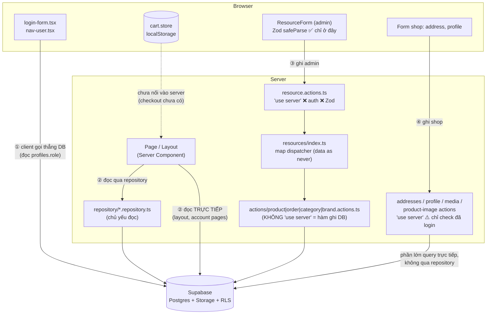
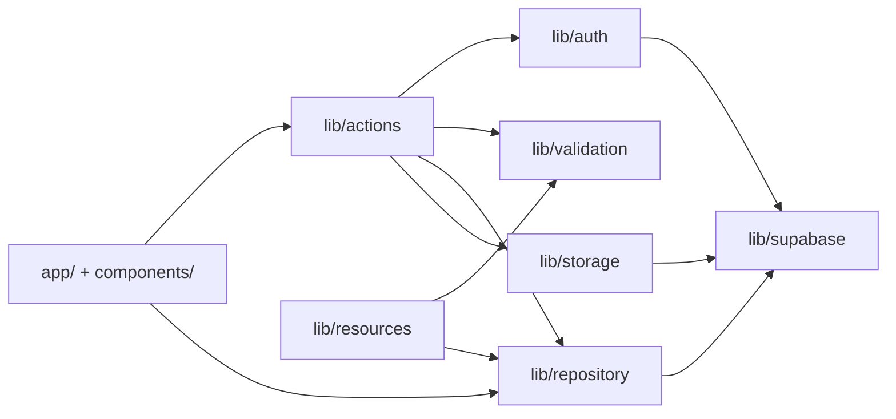

# Review luồng dữ liệu & cách tổ chức dự án — 2026-10-10

> **Phạm vi:** toàn bộ working tree hiện tại (HEAD `d931267` + các file chưa commit: shop, account, cart store…).
> **Quan hệ với tài liệu cũ:** `docs/checkout-va-review-kien-truc.md` (phần B, C) đã liệt kê nhiều vấn đề. File này **kiểm chứng lại** những vấn đề đó trên code hiện tại, **bổ sung các vấn đề mới** (đánh dấu 🆕) và gom tất cả lại theo **đường đi của dữ liệu**.
> **Cách dùng:** tài liệu chỉ nêu vấn đề, giải thích *tại sao*, gợi ý hướng sửa và so sánh các lựa chọn. Code sửa để bạn tự viết.

---

## 0. Tóm tắt

| Chủ đề | Tình trạng | Mức nghiêm trọng nhất |
|---|---|---|
| Build | `npx tsc --noEmit` vẫn báo **14 lỗi** (giống lần review trước) → `npm run build` fail | **critical** |
| Cửa vào ghi dữ liệu (server action) | Thiếu kiểm tra quyền admin, không validate ở server. 🆕 `uploadMedia` bị lộ thành endpoint công khai | **critical** |
| Tầng repository | 🆕 Có query **lọc sai** (`getProductByCategorySlug`). 🆕 Hàm "không tìm thấy" thì `throw` → trang ra 500 thay vì 404 | **critical / warning** |
| Kiểu dữ liệu | Supabase client không gắn `<Database>`, nên mọi query trả về `any`. Chưa có type cho dữ liệu có join | **critical** |
| Từ repository lên UI | 🆕 Logic chọn ảnh chính bị lặp lại và lệch nhau. Page tự gọi Supabase | warning |
| Session / cache | Chưa có `proxy.ts` nên session không được refresh. Revalidate thiếu đường dẫn shop | warning |
| Cart (client state) | 🆕 Giá lưu trong localStorage có thể cũ. 🆕 Nguy cơ hydration mismatch | warning |
| Cây thư mục | Tên số ít/số nhiều lẫn lộn, `lib/actions/` có 2 vai trò, `components/shop` nửa phẳng nửa theo folder. 🆕 Folder rỗng `src/action/` | warning / nitpick |

---

## 1. Bức tranh luồng dữ liệu hiện tại

Dự án đang có **4 đường** chạm vào Supabase. Lý tưởng nhất là chỉ có 2 đường: *đọc qua repository* và *ghi qua server action → repository*.



**Vấn đề tổng quát:** quy ước "chỉ repository chạm DB" có ghi trên giấy (`docs/crudPageWorkFlow.md`), nhưng code thực tế đang vi phạm ở ①, ②-trực tiếp và ④. Khi có nhiều đường vào DB thì:

- phải kiểm tra quyền và validate ở **nhiều chỗ**, nên dễ quên một chỗ;
- muốn đổi một query (vd thêm cột `role` vào profile) thì phải sửa nhiều file;
- người đọc code khó biết "dữ liệu này đến từ đâu".

---

## 2. Vấn đề theo từng chặng của luồng

### 2.1 Cửa vào — Server Actions (bảo mật)

> **Khái niệm cần nhớ:** mọi hàm `export` trong file có `"use server"` đều trở thành một **endpoint HTTP POST công khai**. Ai cũng gọi được, chỉ cần có action ID (nằm trong JS bundle gửi xuống trình duyệt). `admin/layout.tsx` chỉ chặn việc **render trang**, **không** chặn việc gọi action.

| # | Mức | Vấn đề | Vị trí | Tại sao nguy hiểm | Hướng sửa |
|---|---|---|---|---|---|
| A1 | **critical** | `create/update/deleteResourceAction` không kiểm tra user có phải admin không | [resource.actions.ts](../src/lib/actions/resource.actions.ts) | Bất kỳ ai, kể cả chưa đăng nhập, đều có thể gửi request sửa/xoá sản phẩm, đơn hàng. Lúc đó chỉ còn RLS bảo vệ, mà repo chưa có migrations nên **không kiểm chứng được RLS** | Hàm `requireAdmin()` dùng chung, gọi ở dòng đầu mọi admin action |
| A2 | **critical** 🆕 | `uploadMedia(file, folder)` được `export` trong file `"use server"`, nên **chính nó cũng là một action**. Hàm này không kiểm tra login (chỉ `console.log("USER")`) và `folder` do client tự chọn | [media.actions.ts:11](../src/lib/actions/media.actions.ts#L11) | Người lạ có thể upload ảnh vào **bất kỳ folder nào** trong bucket `media`. Lớp kiểm tra login ở `uploadMediaLibraryAction` trở nên vô nghĩa vì có thể gọi vòng qua `uploadMedia` | Chuyển `uploadMedia` thành hàm **nội bộ không export** (hoặc dời sang repository/`lib/storage`). Chỉ export các action đã có guard. Giới hạn `folder` bằng whitelist |
| A3 | **critical** 🆕 | `deleteMediaAction(path)`, `saveProductImages`, `deleteProductImageAction` chỉ kiểm tra "đã đăng nhập", **không** kiểm tra admin | [media.actions.ts:85](../src/lib/actions/media.actions.ts#L85), [product-image.actions.ts](../src/lib/actions/product-image.actions.ts) | **Một khách hàng bình thường** có thể xoá ảnh sản phẩm hoặc file bất kỳ trong storage | Đổi sang `requireAdmin()` |
| A4 | **critical** 🆕 | `getMediaLibrary` là action đọc, không có guard | [media.actions.ts:79](../src/lib/actions/media.actions.ts#L79) | Ai cũng liệt kê được toàn bộ cây thư mục storage | Guard admin, hoặc bỏ action này và cho Server Component gọi thẳng repository |
| A5 | **critical** | Server **không validate** input. Zod chỉ chạy ở client (`resource-form.tsx:122`). `resources/index.ts` cast `data as never` | [resource-form.tsx:122](../src/components/admin/resource-form/resource-form.tsx#L122), [index.ts](../src/lib/resources/index.ts) | Validate ở client chỉ phục vụ UX. Kẻ tấn công gọi action trực tiếp sẽ bỏ qua bước này, gửi field lạ (mass assignment), sai kiểu hoặc sai trạng thái | Chạy lại `validationSchemas[resource].safeParse()` **trong action**. Dùng chung schema ở cả client và server, đó là lợi thế lớn nhất của Zod |
| A6 | **critical** 🆕 *(cần kiểm tra)* | `profiles.role` là `string` và có trong type `Update`. Login form và admin layout đều tin vào cột này | `database.types.ts` (bảng `profiles`) | Nếu RLS cho phép user `update` dòng profile của chính mình, user có thể tự set `role = 'admin'` qua browser client (publishable key nằm công khai) | Kiểm tra policy `profiles` trên dashboard. Chặn cột `role` bằng policy/trigger hoặc tách role sang bảng riêng hay JWT custom claim |
| A7 | warning 🆕 | `redirectTo` từ query string được đưa thẳng vào `router.replace(redirectTo)` | [login-form.tsx:72](../src/components/auth/login-form.tsx#L72) | **Open redirect**: link `/login?redirectTo=https://trang-gia-mao` đưa user sang trang lừa đảo sau khi đăng nhập | Chỉ chấp nhận đường dẫn bắt đầu bằng `/` và **không** bắt đầu bằng `//` |
| A8 | warning | Lỗi được `throw` thẳng từ action | Hầu hết các action | Ở production, Next.js **che message** lỗi của server action, nên UI chỉ nhận được lỗi chung chung | Action trả về kiểu `ActionResult` (`{ ok: true, data } \| { ok: false, code, message }`), như đã mô tả ở `checkout-va-review-kien-truc.md` A.4 |

**Các lựa chọn cho việc kiểm tra quyền:**

| Cách | Ưu | Nhược |
|---|---|---|
| **a. Hàm helper** `requireAdmin()` gọi ở đầu mỗi action | Đơn giản, dễ đọc, dễ debug | Phải nhớ gọi. Quên một chỗ là thủng |
| **b. Hàm bọc (HOF)** `adminAction(schema, handler)`: tự auth, tự `safeParse`, tự bắt lỗi thành `ActionResult` | Không thể quên. Gom 3 việc (auth + validate + xử lý lỗi) vào 1 chỗ | Trừu tượng hơn, cần hiểu generic TypeScript. Debug qua thêm một lớp |
| **c. Chỉ dựa vào RLS** | Bảo vệ ở tầng thấp nhất, kể cả khi gọi DB từ client | Lỗi trả về khó hiểu. Không có migration nên khó review, dễ cấu hình sai. Không chặn được logic nghiệp vụ (vd giới hạn folder upload) |

Gợi ý: làm **a** trước để hiểu bản chất, sau đó nâng lên **b**. **c** luôn nên có, nhưng là lớp phòng thủ cuối chứ không phải lớp duy nhất.

---

### 2.2 Tầng Repository (đúng/sai của query)

| # | Mức | Vấn đề | Vị trí | Tại sao | Hướng sửa |
|---|---|---|---|---|---|
| R1 | **critical** 🆕 | `getProductByCategorySlug` lọc bằng `.eq("category.slug", slug)` nhưng embed `category:categories(...)` **không có `!inner`** | [product.repository.ts:192](../src/lib/repository/product.repository.ts#L192) | Với PostgREST, filter trên bảng được embed **chỉ lọc dữ liệu embed**, không lọc dòng cha. Kết quả: trả về **mọi sản phẩm**, sản phẩm không khớp có `category = null`. Trang danh mục hiển thị sai | **Cách 1:** trang đã có `category.id`, nên lọc thẳng `.eq("category_id", category.id)` (đơn giản và nhanh nhất). **Cách 2:** đổi thành `categories!inner(...)` |
| R2 | **critical** | `getOrderBySlug` lọc theo cột `slug`, nhưng bảng `orders` **không có cột này** | [order.repository.ts](../src/lib/repository/order.repository.ts) | Trang `/admin/orders/[slug]` luôn lỗi | Route của orders dùng `id` hoặc `order_number`. Nghĩa là registry cần biết mỗi resource được tìm theo khoá nào |
| R3 | warning 🆕 | Các hàm `get*BySlug` / `get*ById` gặp "không tìm thấy" thì `throw new Error(...)` | [product.repository.ts:123](../src/lib/repository/product.repository.ts#L123), category, order | Page viết `if (!product) notFound()` nhưng dòng này **không bao giờ chạy**, vì hàm đã throw trước. Kết quả: user gõ sai URL sẽ thấy **trang lỗi 500** thay vì 404 | Thống nhất một quy ước: "không tìm thấy → `null`" (bắt mã `PGRST116`, như `customer-orders.repository.ts` đang làm đúng), "lỗi thật → throw". Dùng `.maybeSingle()` cũng là một cách |
| R4 | warning 🆕 | `getFeatureCategories` **không kiểm tra `error`** và lọc `.eq("is_active", "true")` bằng **string** | [category.repository.ts:72](../src/lib/repository/category.repository.ts#L72) | Lỗi DB bị nuốt, trả về `null`, nên UI hiện "trống" mà không ai biết. So sánh boolean bằng string chỉ chạy được nhờ Postgres tự ép kiểu | Kiểm tra `error`. Dùng `true` |
| R5 | warning 🆕 | Tên hàm không đúng nghĩa: `getFeatureProducts` thực ra là "tất cả sản phẩm active". Trang `/products` gọi chính hàm này, không phân trang | [product.repository.ts](../src/lib/repository/product.repository.ts), `(shop)/[resource]/page.tsx` | Khi có 1000 sản phẩm thì trang list và trang chủ tải toàn bộ | Tách 2 hàm: `getFeaturedProducts(limit)` và `listActiveProducts({ page, pageSize, categoryId })` dùng `.range()` |
| R6 | warning | `getProducts`, `getFeatureProducts`, `getProductBySlug`, `getProductByCategorySlug` lặp lại **cùng một chuỗi select** 4 lần. Có `return data` "chết" sau `return data.map(...)` | [product.repository.ts:50,102](../src/lib/repository/product.repository.ts#L50) | Sửa select ở một chỗ thì quên chỗ khác, dẫn tới dữ liệu không đồng nhất giữa các trang | Tách hằng `PRODUCT_WITH_RELATIONS_SELECT` và một hàm chuẩn hoá dùng chung |
| R7 | warning 🆕 | Ghi dữ liệu nhiều bước **không atomic**: `setDefaultAddress` (reset tất cả rồi set 1); `saveProductImages` (lặp xoá storage → xoá DB → upload → insert, tuần tự) | [addresses.actions.ts:152](../src/lib/actions/addresses.actions.ts#L152), [product-image.actions.ts:270-295](../src/lib/actions/product-image.actions.ts#L270-L295) | Nếu bước 2 lỗi (sai `addressId`, mạng rớt), user **mất luôn địa chỉ mặc định**. Upload ảnh lỗi giữa chừng thì DB và storage lệch nhau. Chạy tuần tự N ảnh thì chậm | Bước nhỏ: kiểm tra địa chỉ tồn tại trước khi reset. Bước chuẩn: Postgres function (`rpc`) cho thao tác cần atomic, và partial unique index `(user_id) WHERE is_default` để DB tự đảm bảo chỉ có 1 địa chỉ mặc định. Với ảnh: upload song song (`Promise.all`), chỉ ghi DB khi upload xong |
| R8 | nitpick | Xử lý lỗi 3 kiểu khác nhau: `throw new Error(error.message)` / `throw new Error("Failed to…")` (mất thông tin gốc) / trả `null` | Toàn bộ repository | Khó debug, UI không phân biệt được loại lỗi | Chọn một quy ước như ở R3 và áp dụng đồng loạt |

---

### 2.3 Kiểu dữ liệu (Types)

| # | Mức | Vấn đề | Hậu quả | Hướng sửa |
|---|---|---|---|---|
| T1 | **critical** | `createServerClient(...)` / `createBrowserClient(...)` **không truyền `<Database>`** ([server.ts](../src/lib/supabase/server.ts), [client.ts](../src/lib/supabase/client.ts)) | Toàn bộ pipeline `database.types.ts → types/database.ts` **không có tác dụng** ở tầng query, vì mọi `data` đều là `any`. Lỗi R1, R2 (sai tên cột) đáng lẽ TypeScript đã báo | Thêm generic. Sau đó TS sẽ báo **thêm lỗi**: đó là lỗi thật đang bị che, không phải lỗi mới |
| T2 | **critical** | `types/database.ts` chỉ có `Row/Insert/Update`, trong khi repository trả về dữ liệu **có join** (`product_images`, `category`, `brand`, `image`) | 6/14 lỗi `tsc` đến từ đây (`product_images` không tồn tại trên `Product`) | **Cách 1:** khai báo tay `ProductWithRelations = Product & {...}`, dễ hiểu nhưng phải sửa tay khi đổi select. **Cách 2:** `QueryData<typeof query>` của supabase-js, tự suy ra từ chuỗi select, luôn khớp nhưng khó đọc hơn. Repository nên **khai báo rõ kiểu trả về** để page không phải đoán |
| T3 | warning | `ResourceConfig` bắt buộc `description` và `related: []` (**tuple rỗng**, không phải mảng) | 4 lỗi `tsc` ở `*.config.ts` | `description?: string`, `related?: ResourceName[]` |
| T4 | warning 🆕 | Có 2 type cho cùng một bảng ảnh: `ProductImages` (sinh từ DB, trong `types/database.ts`) và `ProductImage` (viết tay, trong `lib/resources/product-image.types.ts`) | Hai nguồn sự thật. Khi DB thêm hoặc đổi cột, bản viết tay không tự cập nhật | Bỏ bản viết tay, dùng type sinh từ DB (hoặc `Pick<>` từ nó). Đặt tên số ít `ProductImage` cho nhất quán với `Product`, `Category` |
| T5 | warning 🆕 | Tham số `resource: string` ở khắp nơi (page, action, dispatcher) dù đã có union `ResourceName` | Phải cast `as keyof typeof ...` lặp đi lặp lại. Gõ sai tên resource không bị bắt | Validate `resource` **một lần** ở biên (page/action) bằng type guard `isResourceName(x): x is ResourceName`, phía sau dùng `ResourceName` |
| T6 | nitpick | `database.types.ts` đang lưu ở **UTF-16 LE** (do dùng `>` trong PowerShell khi gen types) | `grep`, `git diff` đọc file thành rác | Gen lại bằng Git Bash, hoặc `| Out-File -Encoding utf8` |

---

### 2.4 Từ Repository lên UI (Page → Component)

| # | Mức | Vấn đề | Vị trí | Hướng sửa |
|---|---|---|---|---|
| U1 | warning 🆕 | **Logic chọn ảnh chính bị lặp và lệch nhau.** Repository đã sort theo `sort_order` rồi gắn field `image`, nhưng `ProductCard` **bỏ qua** field đó và tự tìm lại trong `product_images` mà **không sort** | [product.repository.ts](../src/lib/repository/product.repository.ts) vs [product-card.tsx:20](../src/components/shop/product-card.tsx#L20) | Chỉ một nơi quyết định "ảnh đại diện". Repository đã làm việc này thì component chỉ đọc `product.image`. Đây là nguyên tắc **single source of truth** |
| U2 | warning | Page và layout **tự gọi Supabase** (`auth.getUser()`, query `profiles`) thay vì qua repository/helper. Có 6 file ngoài `lib/` gọi `createClient` | `(shop)/layout.tsx`, `admin/layout.tsx`, 4 trang account | Tạo `lib/auth/session.ts`: `getCurrentUser()` (bọc `cache()` của React để layout và page trong cùng một request không gọi 2 lần), `requireUser(redirectTo)`, `requireAdmin()`. Profile thì đọc qua `getProfileById` |
| U3 | warning | Hành vi khi chưa đăng nhập **không thống nhất**: `addresses/page.tsx` trả `null` (trang trắng), `orders` và `profile` thì redirect | `(shop)/account/*` | Dùng `requireUser()` ở trên. Có thể đặt guard một lần ở `account/layout.tsx` |
| U4 | warning 🆕 | Logic phân luồng sau login (admin → `/admin`) chạy **ở client** và query `profiles` trực tiếp, lặp lại kiểm tra role đã có ở `admin/layout.tsx` | [login-form.tsx:64](../src/components/auth/login-form.tsx#L64) | Đăng nhập bằng server action: action đăng nhập, đọc role, rồi `redirect()` ở server. Logic role nằm một chỗ, client không cần biết tên bảng |
| U5 | warning 🆕 | Đọc dữ liệu qua **server action** (`getMyProfileAction`, `getMediaLibrary`) | [profile.actions.ts:9](../src/lib/actions/profile.actions.ts#L9) | Server action được thiết kế cho **mutation**: chạy tuần tự, POST, không cache. Đọc dữ liệu nên làm trong Server Component rồi truyền xuống bằng props. `getMyProfileAction` hiện **không ai dùng**, có thể xoá |
| U6 | nitpick 🆕 | `admin/[resource]/new/page.tsx` luôn fetch categories **và** brands cho **mọi** resource (kể cả orders), **tuần tự**. Trong khi trang edit dùng `ResourceFormContainer` đọc relation từ config. Hai trang làm cùng một việc theo 2 cách | [new/page.tsx:28-29](../src/app/admin/[resource]/new/page.tsx#L28-L29) | Trang `new` cũng dùng `ResourceFormContainer`. Trong container nên `Promise.all` thay vì `await` trong vòng `for` |
| U7 | nitpick 🆕 | `admin/[resource]/page.tsx` có `return []` trong một page component, text "No products found." cứng cho mọi resource | [page.tsx:36](../src/app/admin/[resource]/page.tsx#L36) | Page phải trả về JSX. Dùng `config.title` cho thông báo rỗng |
| U8 | nitpick | Storefront `(shop)/[resource]` dùng `resourceConfig` của **admin** chỉ để kiểm tra route hợp lệ | `(shop)/[resource]/*` | Shop và admin có nhu cầu khác nhau. Dùng route tường minh `(shop)/products/`, `(shop)/categories/` |
| U9 | nitpick | Còn **22** `console.log` debug (7 cái trong `product.actions.ts`, có log cả `USER` trong media action) | Nhiều file | Xoá. Nếu cần log thì dùng `console.error` cho lỗi thật |

---

### 2.5 Session & Cache

| # | Mức | Vấn đề | Hướng sửa |
|---|---|---|---|
| S1 | warning | Chưa có `src/proxy.ts`. **Next 16 đổi tên `middleware.ts` thành `proxy.ts`**, nên `updateSession()` trong `lib/supabase/middleware.ts` chưa bao giờ chạy | Đọc `node_modules/next/dist/docs/01-app/03-api-reference/03-file-conventions/proxy.md`, tạo `src/proxy.ts` gọi `updateSession`. Không có bước này, token hết hạn sẽ khiến user bị "đăng xuất" ngẫu nhiên |
| S2 | warning | `revalidateResource` chỉ revalidate `/admin/...` | Admin sửa giá thì storefront (`/`, `/products/[slug]`, `/categories/[slug]`) vẫn có thể hiện dữ liệu cũ. Nên revalidate thêm đường dẫn shop, hoặc chuyển sang **cache tag** (một tag `products` vô hiệu hoá mọi trang dùng sản phẩm) |
| S3 | nitpick 🆕 | Layout shop gọi `getUser()` + query `profiles` ở **mọi request** của storefront, rồi page account lại gọi `getUser()` lần nữa | `cache()` của React (U2) gộp các lần gọi trong cùng một request |

---

### 2.6 Client state — Giỏ hàng

| # | Mức | Vấn đề | Tại sao | Hướng sửa |
|---|---|---|---|---|
| C1 | warning 🆕 | Cart lưu `price`, `name` vào localStorage và trang cart tính tổng từ đó | Admin đổi giá thì user vẫn thấy giá cũ cho đến khi xoá giỏ. User cũng có thể sửa giá trong DevTools | Coi `price` trong cart chỉ là **giá hiển thị tạm**. Khi vào `/cart` hoặc `/checkout`, server lấy lại giá thật theo `productId`. Lúc checkout chỉ gửi `{productId, quantity}` |
| C2 | warning 🆕 | `persist` đọc localStorage ngay trên client, trong khi server render với `items = []` | Có thể gây **hydration mismatch**: badge số lượng trên header nhấp nháy, hoặc React cảnh báo | Dùng cờ "đã hydrate" (`useSyncExternalStore` / `persist.onFinishHydration`) và chỉ render số lượng sau khi hydrate xong |
| C3 | nitpick 🆕 | Toàn bộ `cart/page.tsx` là `"use client"`, có hàm `getSubtotal` trong store nhưng page tự `reduce` lại | Logic tính tiền bị lặp | Dùng `getSubtotal` của store. Tách phần client nhỏ nhất có thể (danh sách item) để page vẫn là Server Component |

---

## 3. Cách sắp xếp thư mục

### 3.1 Vấn đề

| Mức | Vấn đề | Chi tiết |
|---|---|---|
| warning | **`lib/actions/` chứa 2 loại file khác bản chất** | `product/category/brand/order.actions.ts` **không** có `"use server"`: thực chất là hàm ghi DB, đáng lẽ thuộc repository. `resource/addresses/profile/auth/media/product-image.actions.ts` mới là server action thật. Nhìn tên không phân biệt được |
| warning | **Repository chỉ "đọc", còn "ghi" nằm rải rác** | Ghi sản phẩm nằm ở `actions/product.actions.ts`. Ghi địa chỉ thì query trực tiếp trong `actions/addresses.actions.ts`. Ghi profile mới đúng chỗ (`profile.repository.ts`) |
| warning | **`lib/resources/` ôm việc của tầng khác** | `repositories.ts` (map `getAll`), `index.ts` (map create/update/delete/find/relation): **5 cái map** cho cùng 4 resource, nằm ở 2 file. `product-image.types.ts` là type. `config.ts` là code chết (không ai import) |
| warning | **Đặt tên số ít/số nhiều lẫn lộn** | `addresses.repository.ts`, `product-images.repository.ts`, `customer-orders.repository.ts` vs `product.repository.ts`. `shop/carts/` vs `shop/category/`, `shop/product/` |
| warning | **`components/shop/` nửa phẳng nửa theo feature** | Phẳng: `product-card`, `product-section`, `hero-section`, `shop-header`, `shop-footer`. Theo folder: `product/`, `category/`, `carts/`, `account/`, `layout/` |
| nitpick 🆕 | **Folder rỗng `src/action/`** | Dễ nhầm với `src/lib/actions/`. Xoá |
| nitpick | File thừa / trùng | `app/admin/data.json` (demo shadcn), `(shop)/account/page.tsx` **rỗng** (gây 1 lỗi tsc), `components/shop/layout/dropdown-menu.tsx` trùng tên với `components/ui/dropdown-menu.tsx`, `components/lexkit/TextEditor.tsx` dùng PascalCase trong khi các file khác dùng kebab-case |
| nitpick | Thiếu chỗ cho | `src/proxy.ts`, `lib/auth/`, `lib/constants/` (trạng thái đơn, phương thức thanh toán), `supabase/migrations/` (RLS, function) |
| nitpick | Tài liệu lệch thực tế | `docs/treeFolder.md` ghi `lib/repositories/`, `lib/validations/`; thực tế là số ít. `docs/architect..md` thừa dấu chấm |

### 3.2 Gom 5 map registry thành 1

Hiện tại để thêm một resource, phải sửa `index.ts` ở 5 chỗ và `repositories.ts` 1 chỗ, chưa kể `validation/index.ts`. Có hai hướng:

| | **A. Một registry khai báo đủ mọi thứ** | **B. Giữ nhiều map, chỉ gom vào 1 file** |
|---|---|---|
| Hình dạng | `resources.products = { config, schema, repo: { list, findByKey, create, update, remove }, lookupKey: "slug" }` | Như hiện tại nhưng chuyển `repositories.ts` vào `index.ts` |
| Ưu | Thêm resource = thêm **1 object**. TypeScript bắt được khi thiếu hàm. Giải quyết luôn R2 (`lookupKey` của orders là `id`) và A5 (schema nằm cạnh repo, action lấy ra để validate) | Ít phải sửa, dễ làm ngay |
| Nhược | Phải refactor `index.ts`, `repositories.ts`, `validation/index.ts` và các chỗ gọi | Vẫn dễ quên một map. Vấn đề `data as never` vẫn còn |

Gợi ý: **A**. Đây đúng là tinh thần "config-driven" mà `docs/crudPageWorkFlow.md` hướng tới.

### 3.3 Tổ chức `lib/` theo tầng hay theo feature

(Đã phân tích ở `checkout-va-review-kien-truc.md` C.3, ở đây tóm tắt lại.)

| | Theo tầng (hiện tại) | Theo feature |
|---|---|---|
| Ví dụ | `repository/`, `actions/`, `validation/` | `features/order/{repository,actions,schema}.ts` |
| Ưu | Khớp với pipeline đang học. Resource pattern admin dựa vào cấu trúc này | Mọi thứ của một nghiệp vụ nằm một chỗ |
| Nhược | Một feature rải ra 4–5 folder | Phải dời nhiều file, lệch với docs |

Gợi ý: **giữ theo tầng**, nhưng làm cho đúng vai trò của từng tầng:

```
lib/
├─ supabase/     client, server, middleware, database.types.ts (UTF-8)
├─ auth/         session.ts — getCurrentUser, requireUser, requireAdmin        ← mới
├─ constants/    order.ts — ORDER_STATUS, PAYMENT_METHOD…                       ← mới
├─ repository/   <entity>.repository.ts — MỌI truy cập DB (đọc + ghi), số ít
│                (gộp product/category/brand/order.actions.ts không-"use server" vào đây)
├─ storage/      media.ts — upload/remove file (hàm nội bộ, không "use server") ← mới (A2)
├─ validation/   <entity>.schema.ts
├─ actions/      CHỈ file "use server" — mỗi action: auth → validate → repository → revalidate → ActionResult
└─ resources/    types.ts, field-utils.ts, <entity>.config.ts, index.ts (registry duy nhất)
```

Quy tắc phụ thuộc, chỉ đi **một chiều**:



Nếu thấy một mũi tên đi ngược chiều, đó là dấu hiệu đặt sai chỗ. Ví dụ hiện tại: `components/` import `createClient` trực tiếp, hay `actions/` tự query bảng.

---

## 4. Thứ tự đề xuất

### Bước 0 — Commit hiện trạng
- [ ] Commit các file chưa track theo nhóm (shop pages, account, cart store, docs) để có mốc rollback trước khi refactor.

### Bước 1 — Vá bảo mật (làm ngay, ít đụng cấu trúc)
- [ ] `lib/auth/session.ts` với `requireUser` / `requireAdmin` (A1, A3, A4, U2).
- [ ] Bỏ `export` của `uploadMedia` khỏi file `"use server"` và whitelist `folder` (A2).
- [ ] `safeParse` trong `resource.actions.ts` (A5).
- [ ] Kiểm tra RLS của `profiles.role` trên dashboard Supabase (A6).
- [ ] Chặn open redirect `redirectTo` (A7).

### Bước 2 — Cho build chạy được
- [ ] Gắn `<Database>` vào các client (T1), rồi sửa các lỗi TS mới hiện ra.
- [ ] Type cho dữ liệu có join (T2), `ResourceConfig` optional (T3), xoá hoặc điền `account/page.tsx`.
- [ ] Sửa R1 (lọc theo `category_id`), R2 (orders tìm theo `id`), R3 (không tìm thấy → `null` → `notFound()`).
- [ ] Kiểm tra: `npx tsc --noEmit` = 0 lỗi, `npm run build` chạy được.

### Bước 3 — Dọn luồng dữ liệu
- [ ] Dời hàm ghi DB từ `actions/*.actions.ts` (không "use server") vào repository.
- [ ] Gom registry (3.2), `Promise.all` ở form container (U6).
- [ ] U1 (một nguồn ảnh chính), R6 (hằng select), xoá `console.log` (U9).
- [ ] `src/proxy.ts` (S1), revalidate cả trang shop (S2).

### Bước 4 — Dọn thư mục
- [ ] Đặt tên số ít, sắp lại `components/shop/` theo feature, xoá `src/action/`, `data.json`, `resources/config.ts`.
- [ ] Cập nhật `docs/treeFolder.md` cho khớp thực tế.

### Bước 5 — Trước khi làm checkout
- [ ] C1, C2 (cart lấy giá thật từ server, xử lý hydration).
- [ ] Bắt đầu `supabase/migrations/` (RLS, partial unique index cho địa chỉ mặc định, function `place_order`). Xem kế hoạch checkout ở `checkout-va-review-kien-truc.md` phần A.

---

## 5. Câu hỏi tự kiểm tra

Thử tự trả lời trước khi sửa code:

1. Nếu mình mở DevTools trên trang shop (chưa đăng nhập admin) và gọi `deleteResourceAction("products", "<id>")`, chuyện gì sẽ xảy ra với code hiện tại? Lớp nào (nếu có) sẽ chặn lại?
2. Tại sao `uploadMedia` không có `"use server"` ở đầu hàm mà vẫn là một server action?
3. Với query `.select("*, category:categories(slug)").eq("category.slug", "ao")`, sản phẩm thuộc danh mục "quan" có bị loại khỏi kết quả không? Muốn loại thì cần thêm gì?
4. Khi `getProductBySlug("khong-ton-tai")` được gọi, user thấy trang 404 hay 500? Vì sao?
5. Sau khi thêm `<Database>` vào `createServerClient`, tại sao số lỗi TypeScript lại **tăng** chứ không giảm? Đó là tin tốt hay tin xấu?
6. Validate bằng Zod ở client đã đủ chưa? Nếu chưa, việc dùng chung một schema cho cả client và server mang lại lợi ích gì?
